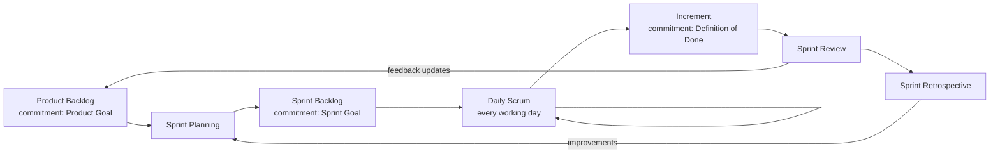

# Part 1 · Day 2 — Agile as a Mindset & Scrum Framework Deep Dive

**Date completed:** 2026-11-17 · **Time spent:** ~5 hours

## Success criteria

| Criterion (copied from the planner) | Done? | Evidence (link or section below) |
| --- | --- | --- |
| Understands agile as values not ceremonies | Yes | [Agile Manifesto and principles](#agile-manifesto-and-principles) · [Exercise 5](#exercise-5-mechanics-vs-mindset-check) |
| Understands the five Scrum values | Yes | [Scrum values](#scrum-values) |
| Explains the Scrum framework accountabilities events and artifacts | Yes | [The Scrum framework](#the-scrum-framework) · [Exercise 1](#exercise-1-scrum-events-and-artifacts-map) |
| Explains at least three org designs affecting the PO accountability | Yes | [Exercise 3](#exercise-3-org-designs-and-the-po-accountability) |
| Describes how the PO interacts across events and the sprint | Yes | [The PO during the sprint](#the-po-during-the-sprint) · [Exercise 1](#exercise-1-scrum-events-and-artifacts-map) |
| Explains why the PO is one person not a committee | Yes | [Product Owner accountability](#product-owner-accountability) |
| Explains PO authority over the backlog while collaborating | Yes | [Product Owner accountability](#product-owner-accountability) · [Exercise 2](#exercise-2-po-authority-in-real-situations) |
| Understands handling PO across multiple teams | Yes | [One PO, many teams: Nexus](#one-po-many-teams-nexus) |
| Explains the PO's contribution to each event conceptually | Yes | [Exercise 1](#exercise-1-scrum-events-and-artifacts-map) |
| Distinguishes Scrum Kanban Scrumban | Yes | [Exercise 4](#exercise-4-scrum-vs-kanban-vs-scrumban) |
| Reflects on mindset vs mechanics | Yes | [Exercise 5](#exercise-5-mechanics-vs-mindset-check) · [Reflection](#reflection) |

## Key learnings

### Agile Manifesto and principles

*Sources: Agile Manifesto, Twelve Principles*

- Agile is four value choices, not a set of meetings: **individuals and interactions** over processes and tools, **working software** over comprehensive documentation, **customer collaboration** over contract negotiation, **responding to change** over following a plan.
- The items on the right still have value. Agile just values the left more. It's about priority, not rejection.
- The principles I connect with most as a product person:
  - Satisfy the customer through early and continuous delivery of valuable software.
  - Welcome changing requirements, even late.
  - Working software is the primary measure of progress, not documents or status reports.
  - Simplicity, "maximizing the amount of work not done," is essential. This is the PO's job when saying "no" or "not now."
  - Continuous attention to technical excellence enhances agility. This links directly to Fowler's argument from Day 1.
- A team can hold every Scrum event and still not be agile if these values are missing.

### Scrum values

*Source: The Scrum Guide 2020*

| Value | What it means in practice |
| --- | --- |
| Commitment | The team commits to its goals and to supporting each other. |
| Focus | Attention on the Sprint's work and the Sprint Goal. |
| Openness | The team and stakeholders are open about the work and its problems. |
| Respect | People respect each other as capable, independent professionals. |
| Courage | Doing the right thing and taking on tough problems. |

The values make the three pillars (transparency, inspection, adaptation) work. Without openness there is no real transparency, and without courage, inspection doesn't lead to change.

### The Scrum framework

*Sources: The Scrum Guide 2020, A Simple Guide to Scrum, Scrum Team Roles and Accountabilities*

- **Scrum is founded on empiricism** (decide based on what is observed) **and lean thinking** (reduce waste).
- **Three pillars:** transparency, inspection, adaptation. Transparency enables inspection, and inspection without adaptation is pointless.
- **Three accountabilities:**
  - **Developers** create the plan (Sprint Backlog), meet the Definition of Done, adapt daily and hold each other accountable.
  - **Product Owner** maximizes the value of the product and manages the Product Backlog.
  - **Scrum Master** establishes Scrum and is accountable for the team's effectiveness. They serve the team, the PO and the organization.
- **Five events:** the Sprint (container, one month or less), Sprint Planning, Daily Scrum, Sprint Review and Sprint Retrospective.
- **Three artifacts, each with a commitment:** Product Backlog → Product Goal, Sprint Backlog → Sprint Goal, Increment → Definition of Done.
- The team is small (10 or fewer), cross-functional and self-managing, with no sub-teams or hierarchy.
- Scrum is "immutable": implementing only parts of it is possible, but the result isn't Scrum.

### Product Owner accountability

*Sources: The Scrum Guide 2020, I'm a New Product Owner, Scrum Team Roles and Accountabilities*

- **Main accountability:** maximize the value of the product, not just maintain a list.
- **Backlog management:** develop and communicate the Product Goal, create and clearly communicate backlog items, order them, and keep the backlog transparent and understood.
- **The PO can delegate backlog work but stays accountable.**
- **The PO decides what is and isn't in the backlog.** Anyone who wants a change has to convince the PO. The organization must respect those decisions.
- **Authority with collaboration:** the PO decides the *what* and the order. The Developers decide the *how* and size the items. The PO can explain trade-offs but doesn't tell the Developers how to build.
- **Why one person, not a committee:**
  - **One clear decision maker** means fast decisions and no waiting for agreement.
  - **One accountable person** means nobody can hide behind the group.
  - **One consistent voice** means the team and stakeholders get a single, coherent order of priorities, not competing ones.
  - A PO can represent many stakeholders. A committee *can* advise the PO, but it can't be the PO.
- **Good PO qualities:** empowered, knowledgeable, empathetic, available and decisive. A big part of the job is saying "no," or "not now."

### The PO during the sprint

*Sources: The Scrum Guide 2020, I'm a New Product Owner*

- **Before and during planning:** prepares the most important backlog items and proposes how the Sprint can increase value.
- **During the Sprint:** stays available to clarify and renegotiate scope as more is learned, without endangering the Sprint Goal. Refines the backlog with the Developers.
- **At the Daily Scrum:** the Scrum Guide says this event is for the Developers. The PO joins as a Developer only if actively working on Sprint Backlog items. The Scrum Alliance article suggests the PO takes part in daily scrums. I see the Guide as the rule and the article as a common practice.
- **At the end:** leads stakeholder feedback at the Review and takes part in the Retrospective as a team member.
- **Only the PO can cancel a Sprint,** and only if the Sprint Goal becomes obsolete.

### One PO, many teams: Nexus

*Sources: Scaling Scrum with Nexus (Scrum.org), The Scrum Guide 2020*

- The Scrum Guide's rule: if a team grows too large, split it into several teams that share **one Product Goal, one Product Backlog and one Product Owner**.
- **Nexus** is a framework for about 3 to 9 Scrum Teams working on one product. It extends Scrum only where needed.
- The main problem it solves is **cross-team dependencies**. The aim is one **Integrated Increment** at least every Sprint.
- What this means for the PO:
  - The PO still owns a single backlog. Teams don't get their own competing backlogs.
  - The PO can delegate refinement to teams but stays accountable for ordering and value.
  - Refinement has to reveal dependencies early so teams can deliver work that integrates.

## Exercises

### Exercise 1: Scrum events and artifacts map

**What I did:** mapped each event to its purpose, the artifacts it uses and produces, and the PO's contribution, in my own words.

| Event | Purpose | Artifacts used → produced | PO's contribution |
| --- | --- | --- | --- |
| Sprint | Container for all the work, one month or less | All three | Guards the Product Goal. The only person who can cancel the Sprint, if its goal becomes obsolete. |
| Sprint Planning | Why is this Sprint valuable, what can be done, how | Product Backlog → Sprint Backlog | Comes with the top items ready and proposes how to increase value. Agrees the Sprint Goal with the team. Leaves the "how" to the Developers. |
| Daily Scrum | Developers inspect progress toward the Sprint Goal and adapt the plan | Sprint Backlog → updated plan | Not required. Stays available afterwards to answer questions. Joins only if working on Sprint items. |
| Backlog refinement (ongoing, not a formal event) | Break items down and add detail | Product Backlog → items ready for a Sprint | Explains the "why" and acceptance criteria. Developers size the items. |
| Sprint Review | Inspect the outcome with stakeholders and decide what's next | Increment → updated Product Backlog | Brings the right stakeholders, runs it as a working session (not a demo only), and reorders the backlog based on feedback. |
| Sprint Retrospective | Improve quality and effectiveness | Definition of Done, ways of working → improvements | Takes part as a team member, including on how well the backlog and stories worked. |

| Artifact | Commitment | Who owns it | PO's link |
| --- | --- | --- | --- |
| Product Backlog | Product Goal | PO | Owns content and order |
| Sprint Backlog | Sprint Goal | Developers | Helps shape the Sprint Goal and negotiates scope |
| Increment | Definition of Done | Developers | Never accepts or releases work that doesn't meet the DoD |

**My reasoning:** mapping it this way showed me that the PO's influence is strongest at the start (Planning, refinement) and the end (Review) of the Sprint. In the middle, the PO's job is to be available, not to steer.

### Exercise 2: PO authority in real situations

**What I did:** applied the authority-with-collaboration rule to situations a product person is likely to meet.

| Situation | Who decides | How I would handle it |
| --- | --- | --- |
| A senior stakeholder asks to add a feature mid-Sprint | PO decides if and where it goes in the backlog | "Not now." Add it to the backlog, order it against the Product Goal, and offer to discuss it at the Review. Don't endanger the Sprint Goal. |
| Developers say a story is too big for one Sprint | Developers own sizing | Split it together. I decide which slice is most valuable first. |
| Developers want time for refactoring | Shared: Developers own the "how" and the DoD | Support it. It protects future speed (Fowler, Day 1). If it's large, make it visible in the backlog. |
| Two stakeholders want opposite priorities | PO | Listen to both, decide based on the Product Goal, and explain the decision openly. |
| Mid-Sprint, we learn a feature is no longer needed | PO | Renegotiate scope with the Developers. If the whole Sprint Goal becomes obsolete, consider cancelling. |

**My reasoning:** the PO's authority is over *what* and *in what order*. It ends where the Developers' authority over *how* and *how much* begins. Collaboration means explaining the "why" behind each decision.

### Exercise 3: Org designs and the PO accountability

**What I did:** compared four organizational setups and how each changes the way the PO accountability works.

| Org design | What it looks like | Effect on the PO accountability |
| --- | --- | --- |
| **Empowered PO** in a product company | PO owns vision, strategy, backlog and KPIs | Matches the Scrum Guide. Fast decisions and clear accountability. |
| **Proxy PO** (business analyst style) | Someone manages the backlog, but real decisions sit with a manager elsewhere | Accountability is split. Decisions slow down because every choice needs approval. The Guide's "one person" rule is weakened. |
| **Client and vendor setup** | The client has the PO. The vendor team builds | The PO is outside the team, so availability is the risk. The vendor's product person may become the client PO's delegate: they manage the backlog, but the client PO stays accountable. |
| **Multiple teams, one product** | Several teams share a product | One PO and one backlog for all teams (Nexus). The PO delegates refinement and focuses on ordering and integration. |
| **Committee or steering group** | A group of managers sets priorities | Breaks Scrum's rule. Priorities conflict and nobody is accountable. A steering group can advise the PO but shouldn't replace them. |

**My reasoning:** the client and vendor setup is closest to Incubyte's pods. Day 1 showed that pods work with minimal dependency on the client's onshore team. So the pod's product person likely acts as the PO's delegate, with clear agreement on which decisions they can make alone. I've added this as an open question.

### Exercise 4: Scrum vs Kanban vs Scrumban

**What I did:** compared the three approaches and decided which fits which situation.

| | Scrum | Kanban | Scrumban |
| --- | --- | --- | --- |
| Rhythm | Fixed-length Sprints | Continuous flow | Flow, often with a regular review and retro rhythm |
| Roles | PO, Scrum Master, Developers | None required | Often keeps Scrum roles, but they're optional |
| Planning | Sprint Planning every Sprint | Pull new work when there's capacity | Planning when the "ready" queue gets low |
| Change during work | Avoided if it endangers the Sprint Goal | Allowed any time, if it fits within WIP limits | Allowed, within WIP limits |
| Main control | Sprint Goal and timebox | Limits on work in progress (WIP) | WIP limits plus some Scrum events |
| Key measures | Sprint Goal achieved, Increment done | Cycle time, throughput, work item age | Mix of both |

**When each fits:**

| Situation | Best fit | Why |
| --- | --- | --- |
| Building a new product with a clear Product Goal | Scrum | Sprints create regular feedback and a goal to plan against. |
| Support, bug fixing or maintenance | Kanban | Work arrives unpredictably, so fixed Sprint plans keep breaking. |
| A team doing both new features and frequent support work | Scrumban | Keeps reviews and retros for learning, with WIP limits to handle interruptions. |

**My reasoning:** the choice depends on how predictable the incoming work is. The more unpredictable it is, the more flow-based the approach should be.

### Exercise 5: Mechanics vs mindset check

**What I did:** for each event, wrote what it looks like when only the mechanics are followed, and what it looks like with the agile mindset.

| Event | Mechanics only | With the mindset |
| --- | --- | --- |
| Sprint Planning | The team takes a list of tasks handed to them | The team agrees a goal and why it matters |
| Daily Scrum | A status report to a manager | Developers adapt their own plan toward the Sprint Goal |
| Sprint Review | A one-way demo, with applause | A working session where stakeholder feedback changes the backlog |
| Retrospective | The same complaints every Sprint, no action | One or two concrete improvements, added to the next Sprint |
| Product Backlog | A long wish list nobody says no to | An ordered list tied to the Product Goal, with items removed when they no longer fit |

**My reasoning:** in every row, the mechanics are the same. The difference is whether the team actually inspects and adapts. That's what "values, not ceremonies" means to me.

## Reflection

What was new for me is that agile is defined by values, and that the Scrum events only work when the team actually inspects and adapts. On my KPI project, calculation errors were found in one big check at the end. With a clear Definition of Done and smaller increments reviewed each Sprint, they would have been found much earlier. I also didn't realise how firm the "one PO, not a committee" rule is, or how much of the PO's job is saying "not now." In future I'll treat every event as a chance to change something, not a meeting to attend, and I'll be clear about which decisions are mine and which belong to the Developers.

## AI use

- **Tools:** Claude.
- **Used for:** structuring my notes into this template, drafting comparison tables, generating the Mermaid diagram in Exercise 1, and checking that every success criterion has evidence.
- **Diagram:** the Mermaid diagram in Exercise 1 was generated by Claude. I reviewed it against the Scrum Guide to check the event and artifact flow.
- **What I checked and corrected:**
  - Checked the Scrum facts (events, timeboxes, commitments, who can cancel a Sprint) against the 2020 Scrum Guide.
  - Noted that the articles disagree on two points and recorded what the Scrum Guide says: whether the PO attends the Daily Scrum, and team size (Scrum Guide: 10 or fewer in total; Scrum Alliance: 3 to 9 or 3 to 8 developers).
  - The Kanban and Scrumban comparison and the org designs go beyond the pasted articles, so I reviewed them against my own understanding. I've listed them as topics to confirm with my buddy.

## Open questions

1. At Incubyte, when the client has its own Product Owner, is the pod's product craftsperson the PO, a delegate, or a proxy? Which backlog decisions can I make alone?
2. Do pods usually run Scrum, Kanban or Scrumban, and who decides?
3. The Scrum Guide says the Daily Scrum is for Developers, but Scrum Alliance suggests the PO attends. What's the expected practice in our pods?

## Changes after review

- 2026-11-18: Updated the AI use section to state that the Mermaid diagram was generated with Claude, after a question from my CoE leader.
