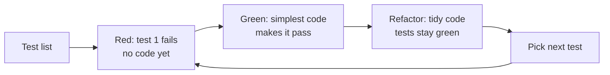

# Part 1 · Day 3 — Extreme Programming & Agile-as-Craft

**Date completed:** 2026-11-17 · **Time spent:** ~4 hours

## Success criteria

| Criterion (copied from the planner) | Done? | Evidence (link or section below) |
| --- | --- | --- |
| Understands XP and its core practices | Yes | [Extreme Programming](#extreme-programming) · [Exercise 1](#exercise-1-xp-practices-and-why-a-craft-consultancy-uses-them) |
| Understands TDD conceptually and why test-first matters | Yes | [Test-Driven Development](#test-driven-development) · [Exercise 2](#exercise-2-test-first-thinking-on-a-real-feature) |
| Understands CI/CD and Definition of Done from a product lens | Yes | [Continuous Integration](#continuous-integration) · [Definition of Done](#definition-of-done) · [Exercise 3](#exercise-3-definition-of-done-for-a-pod-feature) · [Exercise 4](#exercise-4-ci-rules-through-a-product-lens) |
| Understands the PM role inside an XP team | Yes | [The PM in an XP team](#the-pm-in-an-xp-team) · [Exercise 5](#exercise-5-pm-role-in-three-team-styles) |
| Reflects honestly on what is new in agile-as-craft | Yes | [Reflection](#reflection) |

## Key learnings

### Extreme Programming

*Source: Extreme Programming, Martin Fowler*

- XP was created by Kent Beck and first used as a full set of practices on the C3 project. It was the leading agile method before Scrum became dominant.
- Beck describes XP as a progression: **values → principles → concrete practices**.
- XP popularized continuous integration, refactoring, TDD and agile planning.
- **Its key strength is combining technical and management practices.** Fowler notes that Scrum on purpose includes only management practices, which makes it vulnerable to "Flaccid Scrum": the events run, but the code quality slowly decays.
- Fowler sees it as more useful to ask whether a team works *in the spirit* of XP than to judge whether it "does XP."

### Test-Driven Development

*Source: Test Driven Development, Martin Fowler*

- **First, write a list of test cases.** Then repeat three steps for each one:
  1. **Red:** write a test for the next small piece of behaviour. It fails because the code doesn't exist yet.
  2. **Green:** write just enough code to make it pass.
  3. **Refactor:** clean up the new and old code while all tests stay green.
- **Why test-first matters:**
  - Every piece of code exists because a test asked for it, so the result is self-testing code.
  - Thinking about the test first forces thinking about *how the code will be used* before *how it works*, which leads to better design.
- **The most common mistake is skipping refactor.** Without it you get a messy pile of code fragments, even if they're tested.
- **What it means for me as a PM:** good test cases are concrete examples of behaviour. That is exactly what good acceptance criteria are. I won't write the code, but I can help write the test list.
- A related article in the testing list, "Tests as data" (Matteo Vaccari, 2026), argues that when AI writes code, *customer tests* become the main contract between humans and AI. That puts readable, example-based acceptance tests even more on the product side.

### Continuous Integration

*Source: Top 10 Rules for Continuous Integration, Dave Farley*

- **CI isn't a tool.** Running Jenkins doesn't mean you're doing CI. CI is about making every change visible and checking it against everyone else's work as early as possible.
- **There is only one version that matters: the current one.** When everyone integrates constantly, there's no "integration hell" and no need to guard code ownership.
- **Commit at least once a day.** Farley commits every 10 to 15 minutes, after each red-green-refactor cycle.
- **CI is the first stage of a deployment pipeline.** The commit stage should give feedback in under 5 minutes with about 80% confidence. The whole pipeline, from commit to releasable, should take under an hour.
- **His 10 rules, in short:**
  1. Run the commit tests locally before committing.
  2. Wait for the commit build result. Don't walk away.
  3. If it fails, fix or revert within 10 minutes.
  4. If a teammate left the build broken, revert their change for them.
  5. If someone else spots your broken build first, that's a "build sin."
  6. Once the commit stage passes, move on to new work.
  7. If a test fails after your commit, it's your responsibility, even if it's in someone else's code.
  8. If it's unclear who broke it, everyone who could have gets together and decides.
  9. Keep watching your change as it moves through the rest of the pipeline.
  10. If a later stage fails, fix it immediately, even if it means pulling people out of meetings.
- **The aim is software that is always releasable.** A single failing test means the release candidate is rejected.

### Definition of Done

*Source: Definition of Done, Agile Alliance*

- **A visible checklist the team agrees on.** It lists what must be true before a story counts as "done," not just "done programming" but tested, deployable and documented ("done-done").
- **Benefits:** guides discussion and design before building, limits rework, and avoids misunderstandings between the team and the PO.
- **Pitfalls:**
  - Making the list too long. It should be the *minimum* for every story.
  - Forgetting that some stories need extra, story-specific criteria.
  - Leaving it as an unwritten shared understanding instead of a visible list.
- **Sign it's really used:** the team can point to it, and uses it to decide whether work counts at the end of a Sprint.
- This links to Day 2: in the Scrum Guide, the DoD is the commitment that turns work into an Increment.

### The PM in an XP team

*Sources: Extreme Programming (Fowler), the Day 2 Scrum readings, and my wider reading on XP*

- **XP has a "customer" role,** someone who works with the team every day, writes stories, sets priorities and defines acceptance tests. In a product team, that's mostly the PM.
- **The PM is part of the team, not a hand-off point.** Stories are small, discussed together, and turned into concrete examples (Given / When / Then) before building.
- **Quality is part of the plan, not an extra.** Refactoring and tests are in every story, so the PM doesn't negotiate them away.
- **Releases are a business decision.** Because the software is always releasable, the PM decides *when* to release, not engineering.

### Incubyte Inspiration

*Source: Incubyte Resources and accelerators, Inspiration*

The talks Incubyte recommends (Uncle Bob's three laws of TDD, reading code, SOLID principles, testing legacy code, microservices, agile estimating and code quality) show what a craft consultancy values. Nearly all of them are about engineering discipline, not process. I've picked the three laws of TDD and agile estimating as the two to watch first.

## Exercises

### Exercise 1: XP practices and why a craft consultancy uses them

**What I did:** listed XP's core practices, explained each in plain words, and linked each to quality built in, fast feedback, and iterating with discipline.

| Practice | In plain words | Why a craft consultancy works this way | What it means for me as a PM |
| --- | --- | --- | --- |
| Pair programming | Two people, one problem, one keyboard | Constant review catches bugs while they're cheap. Knowledge spreads, so there's no single point of failure. | Two people on one story is not "half speed." It's quality and resilience. |
| Test-Driven Development | Write the test, then the code, then tidy up | Quality is built in from the first line | Examples in my stories become the first tests |
| Continuous integration | Everyone merges small changes many times a day | Problems surface in minutes, not weeks | Small stories make small commits possible |
| Refactoring | Improve the structure without changing behaviour | Keeps cruft low, so speed stays high (Fowler, Day 1) | Refactoring is part of every story, not a separate "tech debt sprint" |
| Simple design | Build only what's needed now, in the clearest way | Avoids paying for features nobody uses (YAGNI) | Match the Agile principle "maximize the work not done" |
| Collective ownership | Anyone can change any part of the code | No waiting on one "owner." The team, not individuals, is responsible. | I talk to the team about a problem, not to one person |
| Small releases and planning | Plan and ship in short, frequent cycles | Fast feedback from real users | I write thin slices that can be released alone |

**My reasoning:** every practice shortens a feedback loop: from seconds (TDD) to minutes (CI) to days (small releases). That is what "agile-as-craft" means to me.

### Exercise 2: Test-first thinking on a real feature

**What I did:** applied test-first thinking to a feature like the KPIs from my past work: *"Show month-on-month revenue growth."* As a PM I wrote the **test list first**, as Fowler describes, before any code.

**Test list (as examples):**

| # | Given | When | Then |
| --- | --- | --- | --- |
| 1 | Last month 100, this month 120 | Growth is calculated | Shows +20.0% |
| 2 | Last month 120, this month 90 | Growth is calculated | Shows −25.0% |
| 3 | Last month 0, this month 50 | Growth is calculated | Shows "n/a (no base)" instead of an error |
| 4 | Last month's data is missing | Growth is calculated | Shows "Data unavailable" |
| 5 | Last month 3, this month 4 | Growth is calculated | Rounds to one decimal: +33.3% |

**How the cycle would run for test 1:**

**What happened:** writing tests 3 to 5 raised three **product questions** before any code was written: what to show when there's no base, what to show when data is missing, and how to round. On my real KPI project, problems like these were found in the final maths check. Test-first moves them to the start.

*Note: this is a conceptual exercise for the product track. I didn't write code.*

### Exercise 3: Definition of Done for a pod feature

**What I did:** drafted a minimum Definition of Done a pod could start with, keeping it short as the Agile Alliance advises.

**General DoD (every story):**

- [ ] Acceptance criteria met, with each example automated as a test
- [ ] Code written test-first and refactored, with all tests passing
- [ ] Merged to main and the commit build is green
- [ ] Deployed to the test environment through the pipeline
- [ ] Peer-reviewed or written in a pair
- [ ] Product walkthrough by me against the acceptance criteria
- [ ] No new accessibility issues
- [ ] Documentation or release notes updated if behaviour changed

**Story-specific extras (for the growth KPI):**

- [ ] Results checked against a known dataset with expected values
- [ ] Edge cases (no base, missing data) display as agreed

**My reasoning:** the general list is the minimum for *every* story. The extras cover risks that only apply to this one. That split avoids the "too long" pitfall.

### Exercise 4: CI rules through a product lens

**What I did:** took Farley's ideas and wrote down what they mean for my behaviour as a PM.

| CI idea | Why it matters for the product | What I will do |
| --- | --- | --- |
| Commit at least daily, in small steps | Small changes are easier to integrate and test | Write stories small enough to finish in a day or two |
| A broken build is fixed or reverted within 10 minutes | Nobody can ship while it's red | Never ask the team to "finish the feature first" while the build is broken |
| Software is always releasable | Releasing becomes a business choice, not a technical event | Plan releases around user value and timing |
| A test failure is a strong signal | Hiding failures hides risk | Ask about failing tests in reviews rather than accepting "it's flaky" |
| The whole pipeline in under an hour | Fast feedback on every change | Treat slow pipelines as a product risk worth investing in |

**My reasoning:** CI is an engineering practice, but its main benefit to me is that I can release whenever it makes sense for users.

### Exercise 5: PM role in three team styles

**What I did:** compared how the PM works in three kinds of teams.

| | Top-down team | Scrum-only team | XP team |
| --- | --- | --- | --- |
| How requirements arrive | Big documents handed down | Backlog items, refined each Sprint | Small stories turned into examples together |
| Who owns quality | A QA phase at the end | Depends on the team. Can turn "flaccid." | Everyone, every day, through TDD, CI and pairing |
| PM's day-to-day | Writes specs, then waits | Manages the backlog, attends events | Works with the team daily, writes acceptance tests, answers questions fast |
| Feedback speed | Months | Every Sprint | Minutes (CI) to days (small releases) |
| Main risk | Late surprises | Good process, decaying code | Needs a PM who is truly available |

**My reasoning:** the biggest change is availability. In an XP team, a slow answer from me stops the whole team.

## Reflection

What's genuinely new for me is that agile isn't only a set of events. Without technical practices like TDD and CI, Scrum can run perfectly while the code gets worse. I hadn't realised that test-first thinking is something I can contribute to as a PM: writing the test list for the growth KPI raised product questions that, on my past project, only surfaced in the final maths check. I also see release timing differently now. If the software is always releasable, when to release is my product decision. In future I'll write stories as concrete examples, keep them small enough to integrate daily, and protect refactoring time instead of trading it for speed.

## AI use

- **Tools:** Claude.
- **Used for:** structuring my notes into this template, drafting tables, generating the Mermaid diagram in Exercise 2, and checking that every success criterion has evidence.
- **Diagram:** the Mermaid diagram in Exercise 2 was generated by Claude. I reviewed it against Fowler's description of the red-green-refactor cycle.
- **What I checked and corrected:**
  - Checked Farley's 10 rules against the video transcript.
  - Checked the TDD steps and the "list first" step against Fowler's article.
  - Pair programming, simple design, collective ownership and the XP "customer" role go beyond the pasted articles, so I've marked that section as wider reading.
  - Kept Exercise 2 clearly labelled as a conceptual product exercise, not code.

## Open questions

1. At Incubyte, does the product craftsperson write the acceptance examples (Given / When / Then) alone, or with dev and QA?
2. Is there a standard Incubyte Definition of Done that pods start from?
3. How do product people usually stay aware of pipeline status? Do they follow the CI board?

## Changes after review

- 2026-11-18: Updated the AI use section to state that the Mermaid diagram was generated with Claude, after a question from my CoE leader.
