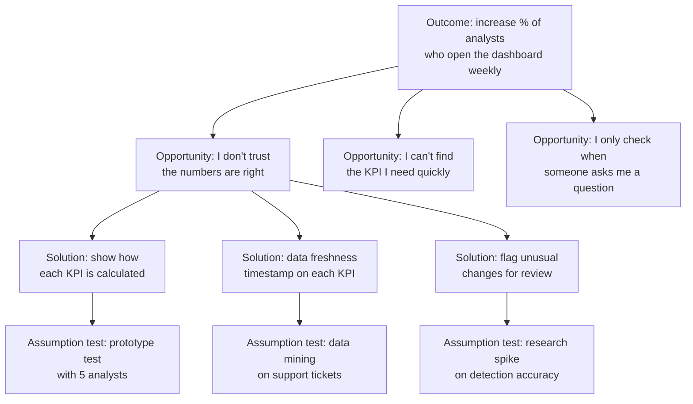

# Part 1 · Day 4 — Product Discovery Customer Understanding & Validating Assumptions

**Date completed:** 2026-11-19 · **Time spent:** ~4 hours

## Success criteria

| Criterion (copied from the planner) | Done? | Evidence (link or section below) |
| --- | --- | --- |
| Understands problem vs solution validation | Yes | [Problem discovery vs solution validation](#problem-discovery-vs-solution-validation) · [Exercise 2](#exercise-2-practice-opportunity-solution-tree) |
| Describes how a PO includes discovery and validation | Yes | [How a PO includes discovery](#how-a-po-includes-discovery) |
| Identifies how discovery aspects contribute to outcomes | Yes | [How discovery contributes to outcomes](#how-discovery-contributes-to-outcomes) |
| Applies a customer segmentation approach | Yes | [Exercise 3](#exercise-3-segmenting-users) |
| Applies a technique for conflicting user needs | Yes | [Exercise 4](#exercise-4-resolving-conflicting-needs) |
| Knows approaches to connect developers to users | Yes | [Connecting developers to users](#connecting-developers-to-users) |
| Understands how scrum supports validating assumptions | Yes | [How Scrum supports validating assumptions](#how-scrum-supports-validating-assumptions) |
| Compares validation approaches by cost and learning | Yes | [Exercise 5](#exercise-5-validation-approaches-by-cost-and-learning) |
| Connects decisions to user feedback | Yes | [Exercise 1](#exercise-1-trace-decisions-back-to-a-user-signal) · [Closing the loop after launch](#closing-the-loop-after-launch) |

## Key learnings

### Problem discovery vs solution validation

*Sources: Product Discovery Basics (Teresa Torres), Product Discovery (Marty Cagan)*

- **Discovery** is deciding *what* to build. **Delivery** is building, shipping and maintaining it.
- Cagan splits discovery into two separate questions:
  1. **Problem discovery:** are there real users who want this? Validate the opportunity.
  2. **Solution validation:** is our solution useful, usable and feasible? Validate the design with users and engineers.
- Cagan finds the problem side is usually easier. Finding a solution that works is the hard part.
- In Torres's terms: **interviews discover opportunities** (the problem space), and **assumption tests discover solutions** (the solution space).
- **Opportunity vs solution:** an opportunity is a need, pain point or desire. A solution is one way to address it. Test: "Is there more than one way to address this?" If not, it's a solution in disguise.

### How a PO includes discovery

*Sources: Product Discovery (Cagan), Product Discovery Basics (Torres), Day 2 Scrum readings*

- **Discovery isn't a phase before delivery.** Cagan's warning: a fixed 4-week "requirements" phase means the team builds whatever was planned, even after users showed no interest. The fault then falls on the PM.
- **It's continuous.** Digital products are never done, so the PO stays connected to customers every week, not once per project.
- **It's done with a product trio:** PM, designer and engineer interview and test together.
- **Every backlog item is a bet.** Discovery reduces the risk of that bet before it enters the delivery backlog.
- **Outcomes, not outputs.** Success is a change in customer behaviour, not "we shipped it."

### How discovery contributes to outcomes

*Sources: Product Discovery Basics, Opportunity Solution Trees (Torres)*

| Discovery aspect | How it contributes to the outcome |
| --- | --- |
| A clear product outcome | Sets the scope. The team knows which opportunities matter and avoids chasing every request. |
| Weekly story-based interviews | Keeps the team grounded in real needs and beats the "curse of knowledge" (forgetting what it's like not to know the product). |
| Opportunity solution tree | Connects business value (outcome) to customer value (opportunities), so we create both. |
| Comparing at least three solutions | Better decisions come from comparing options, not asking "will this one work?" |
| Assumption testing | Finds which ideas will fail *before* building them, so effort goes to ideas with evidence. |
| Product trio | Shared understanding means faster, better decisions and fewer hand-offs. |

**Three outcome types (Torres):** business outcomes (such as revenue or churn), product outcomes (a customer behaviour in the product) and traction metrics (use of one feature). A product outcome is the right level for a team: it's within their control and leads the business outcome.

### Connecting developers to users

*Sources: Torres articles, Cagan, Day 2 Scrum readings*

1. **Engineers join the product trio** and take part in customer interviews.
2. **Engineers take part in discovery,** not just delivery. Cagan says they "can and should actively participate."
3. **Research spikes:** engineers test feasibility assumptions themselves, as a backlog item in the Sprint.
4. **Working Sprint Reviews:** developers hear stakeholder and user feedback on the Increment directly.
5. **Watching real behaviour:** developers watch recordings of unmoderated prototype tests and look at product analytics.

### How Scrum supports validating assumptions

*Sources: The Scrum Guide 2020 (Day 2), Assumption Testing (Torres)*

- **Scrum is based on empiricism:** decisions come from what is observed. That's the same idea as assumption testing.
- **Each Sprint is a short project** with a limited cost, so a wrong bet costs at most one Sprint.
- **The Product Backlog is emergent.** It can change based on what we learn.
- **The Sprint Review is a working session** where stakeholders inspect the Increment and the backlog is adapted.
- **Research spikes and prototypes fit into a Sprint** as normal backlog items (Torres suggests this directly).
- **The limit:** Scrum validates what has *already been built*. On its own, it risks Cagan's "very expensive prototype." Testing assumptions *before* building is still needed.

### Closing the loop after launch

*Sources: Opportunity Solution Trees, Assumption Testing (Torres), Product Discovery (Cagan)*

- **Assumption tests help decide what to build.** **Experiments (such as A/B tests) measure the impact of what was built.**
- Shipping isn't the end. Measure the product outcome after release, and change the product based on what users actually *did*, not on what was planned.
- Update the opportunity solution tree every three to four interviews, since our own releases change the opportunity space.
- Don't over-react to one interview, sales call or support ticket. Treat them as inspiration for the next interviews, not as direct opportunities.

## Exercises

### Exercise 1: Trace decisions back to a user signal

**What I did:** took real decisions I've made during this COE, and traced each one back to a signal from its "users," the reviewers. Where I couldn't trace one, that's a gap.

| Decision I made | User signal behind it | Traceable? |
| --- | --- | --- |
| Moved my submissions from PDF to Markdown files on GitHub | The submission guidelines said reviewers often couldn't open PDF or Word links | Yes, direct |
| Cut my Day 1 doc from 11 pages to a short template | The guidelines said "short and complete beats long and generic" | Yes, direct |
| Added a clear note that the Mermaid diagrams were AI-generated | My CoE leader asked who made the diagrams | Yes, direct question from a user |
| Added several exercises to each day | The guidelines list skipped exercises as a common reason for "Partial" | Partly. It comes from published criteria, not feedback on *my* work. |
| Based my examples on my past KPI project | No signal. It was my own choice. | **No, this is the gap** |

**What I learned:** most of my changes came from published guidelines or one question, not from feedback on my actual submissions. I haven't had a review yet, so I don't know whether reviewers find my KPI examples useful. To close this gap, I'll ask my reviewer one specific question: "Are the examples from my past work useful, or would examples from an Incubyte context be better?"

### Exercise 2: Practice opportunity solution tree

**What I did:** built a practice opportunity solution tree for a dashboard product like the one from my past work.

*Important: Torres says opportunities must come from real story-based interviews, never made up. I haven't interviewed users for this, so every opportunity here is an assumption. This is practice in using the structure, not a real tree.*

**Problem vs solution validation in this tree:**

| Level | Question | Validation type |
| --- | --- | --- |
| Opportunities | Do analysts really distrust the numbers? | Problem discovery, through story-based interviews ("Tell me about the last time you used a KPI in a decision") |
| Solutions and assumption tests | Will a calculation explainer make them trust it? | Solution validation, through assumption tests |

**My reasoning:** I chose "I don't trust the numbers" as the target opportunity because, on my past project, calculation errors were the biggest problem. That makes it my most likely real opportunity. It's still an assumption until interviews confirm it.

### Exercise 3: Segmenting users

**What I did:** applied Torres's two ways of splitting an outcome to the same dashboard practice scenario.

| Approach | Segments | Why it helps |
| --- | --- | --- |
| By customer tenure | New users (first month) · regular users · lapsed users | Each group has different needs: learning, speed, or a reason to come back |
| By journey step | Finding a KPI · understanding it · acting on it | Each step can have its own team or outcome |

**Which I'd use:** tenure, because "weekly use" is mostly about getting new users to form the habit and bringing lapsed users back. Those groups need different solutions.

*Wider reading, not from the articles: segmenting by role (analyst, manager, executive) is another common approach. I use it in Exercise 4.*

### Exercise 4: Resolving conflicting needs

**What I did:** took a typical conflict and applied two techniques from the readings: finding the underlying need ("Is there more than one way to address this?") and judging against the outcome.

**The conflict (practice scenario):** analysts want **more detail** on each KPI. Executives want **less**, just the headline number.

| Step | What I did |
| --- | --- |
| 1. Check for solutions in disguise | "More detail" and "fewer numbers" are both solutions. Asking *why* gives the opportunities: analysts need to check the number is right, and executives need to decide quickly. |
| 2. Look for a shared need | Both need to **trust the number quickly**. |
| 3. Judge against the outcome | The outcome is weekly analyst use, so the analysts' need comes first. The executives' need must not be harmed. |
| 4. Compare three solutions | (a) Headline number with detail available on click. (b) Separate views by role. (c) A short summary line explaining each number. |
| 5. Test assumptions | Prototype test (a) and (c) with both groups. Research spike on (b) to check the effort. |

**My reasoning:** the conflict looked like "detail vs no detail," but it was about two *solutions*. The underlying needs don't conflict much.

### Exercise 5: Validation approaches by cost and learning

**What I did:** compared the validation approaches from the readings by cost and quality of learning.

| Approach | Cost and time | Quality of learning | Best for |
| --- | --- | --- | --- |
| Data mining (analytics, support tickets) | Very low · hours | Shows what happened, but often not why | Early signals and checking how big something is |
| One-question survey | Low · a day or two | Real past behaviour, but shallow | Checking how common a behaviour is |
| Story-based interview | Low to medium · an hour each | Deep understanding of needs and context | Problem discovery |
| Prototype test (for example, unmoderated) | Medium · days | Observed behaviour at a specific moment | Desirability and usability assumptions |
| Research spike | Medium · part of a Sprint | Strong evidence on effort and risk | Feasibility assumptions |
| A/B test after building | High · needs a full build and enough traffic | Strong evidence of real impact | Measuring impact after release |
| Building the full product and seeing what happens | Very high · months | Clear, but arrives too late | Should be avoided (Cagan's "very expensive prototype") |

**My reasoning:** the cheapest tests that answer the riskiest assumption come first. Assumption mapping (Torres, citing David Bland) picks those: high importance, little evidence.

## Reflection

What was new for me is the clear line between finding the problem and validating the solution, and that the solution side is usually harder. Cagan's 4-week story felt familiar: discovery treated as a fixed phase, after which the team builds what was planned regardless of what was learned. Exercise 1 surprised me. Even in my own COE work, one of my main choices (using my past KPI project as examples) had no user signal behind it. I also had to remind myself that my practice tree uses made-up opportunities, which is exactly what Torres warns against. In future I'll start from real interviews, test assumptions before building, and ask reviewers and users specific questions so my decisions have a signal behind them.

## AI use

- **Tools:** Claude.
- **Used for:**
  - structuring my notes into this template and drafting the tables
  - **generating the Mermaid opportunity solution tree in Exercise 2**
  - checking that every success criterion has evidence
- **What I checked and corrected:**
  - Checked the opportunity solution tree structure (outcome → opportunities → solutions → assumption tests) against Torres's article.
  - Marked the practice tree clearly as made-up opportunities, because Torres warns against using made-up ones in a real tree.
  - Exercise 1 uses only real decisions from my own COE work, so it isn't invented.
  - Marked role-based segmentation and the list of ways to connect developers to users as partly wider reading, beyond the articles.

## Open questions

1. At Incubyte, does the pod's product person run customer interviews directly, or does that go through the client?
2. When a client gives the pod a fixed feature list, how much discovery are we expected to do before building?
3. Are there Incubyte templates for opportunity solution trees or assumption-test tracking?

## Changes after review

- None yet.
