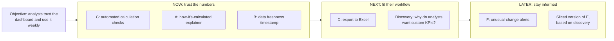

# Part 1 · Day 5 — Prioritization Frameworks Done Rigorously

**Date completed:** 2026-11-20 · **Time spent:** ~4 hours

## Success criteria

| Criterion (copied from the planner) | Done? | Evidence (link or section below) |
| --- | --- | --- |
| Knows major frameworks and their trade-offs | Yes | [Frameworks and their trade-offs](#frameworks-and-their-trade-offs) |
| Articulates why a framework produced a decision | Yes | [Exercise 1](#exercise-1-rice-and-moscow-on-one-feature-list) · [Why the framework produced this decision](#why-the-framework-produced-this-decision) |
| Connects estimation to the effort score | Yes | [Estimation and the effort score](#estimation-and-the-effort-score) · [Exercise 2](#exercise-2-from-estimate-to-effort-score) |
| Builds an outcome-driven roadmap | Yes | [Outcome-driven roadmaps](#outcome-driven-roadmaps) · [Exercise 3](#exercise-3-now-next-later-roadmap) |
| Applies two frameworks to one list and explains the difference cleanly | Yes | [Exercise 1](#exercise-1-rice-and-moscow-on-one-feature-list) |

## Key learnings

### Frameworks and their trade-offs

*Sources: RICE (Intercom), Prioritization Frameworks guide (ProductPlan), Kano Model (ProductPlan). WSJF is from my wider reading.*

| Framework | What it optimizes | Inputs | Main trade-off |
| --- | --- | --- | --- |
| **RICE** | Total impact per unit of effort | Reach, Impact, Confidence, Effort | Rigorous and comparable, but blind to dependencies, "table stakes" and risk. Only as good as its estimates. |
| **ICE** | Speed of deciding | Impact, Confidence, Ease | Fast, but less rigorous. No reach, so pet ideas can score high. |
| **MoSCoW** | What a specific release needs | Must, Should, Could, Won't | Easy for stakeholders to understand, but doesn't rank items within a category. Everything tends to become a "Must." |
| **Kano** | Customer satisfaction | How customers react to having or missing a feature | Shows that *basic* features must exist even if they don't delight. Needs real customer surveys to be valid. |
| **WSJF** (Weighted Shortest Job First) | Economic value of doing things in the right order | Cost of delay ÷ job size | Captures time-criticality, which RICE misses. Cost of delay is hard to estimate. |
| **Value vs complexity** and **weighted scoring** | Benefit compared with cost | Scores per criterion | Flexible, but the chosen weights can hide bias. |

**What each guards against (from Intercom):** Reach stops us favouring pet ideas we'd use ourselves. Impact keeps the focus on the goal. Confidence curbs exciting but unproven ideas. Effort stops us underestimating cost.

**Kano categories:** *basic* (expected, and dissatisfying if missing), *performance* (more is better, linearly), and *excitement* (delighters that customers don't miss if absent). Two kinds of feature should stay off the roadmap: *indifferent* ones and ones that cause *dissatisfaction*.

### Estimation and the effort score

*Sources: RICE (Intercom), Day 2 Scrum Guide*

- **RICE effort is in person-months:** the total time across product, design *and* engineering, not just coding.
- **Keep it rough:** whole numbers, or 0.5 for anything well under a month. Precision here is false precision.
- **Effort divides the score,** so an underestimate makes an idea look much better than it is.
- **The Developers own sizing** (Scrum Guide). As a PM, I shouldn't invent the effort number alone. If I have to make a first guess, I lower the *confidence* score to reflect that.
- **Confidence covers all the estimates.** Intercom's 100% means real metrics for reach, research for impact *and* an engineering estimate for effort.

### Outcome-driven roadmaps

*Sources: Product Roadmaps guide (ProductPlan), Prioritization Frameworks guide (ProductPlan), Opportunity Solution Trees (Torres, Day 4)*

- **A roadmap communicates the *why* and *what*,** not a list of dated features. In agile, it's a living document.
- **Now / Next / Later:** "Now" is committed and well understood. "Next" is likely. "Later" is directional. Certainty drops as you go right, so dates are left out.
- **Every item should pass four filters:** real value to users, evidence of that value, an owner, and a fit with the plan.
- **Tie themes to OKRs:** each objective is a theme, and items link to a measurable key result.
- **Include the "vegetables":** security, scalability and technical debt get space up front, or they show up later as delays.
- **Tailor it to the audience:** executives get outcomes, engineers get detail, and customers get benefits without dates.

### Saying no and slicing scope

*Sources: Prioritization Frameworks guide (ProductPlan), I'm a New Product Owner (Day 2)*

- **Feedback should inform, not dictate.** Customers describe their solution, but our job is the underlying problem.
- **A reactive backlog becomes a "junkyard"** of sales requests and one-off asks.
- **"Not now" is often better than "no."** It keeps the relationship and the backlog honest.
- **Slice to the burning problem first:** the smallest version that solves the core problem, with the roadmap showing what comes later.

## Exercises

### Exercise 1: RICE and MoSCoW on one feature list

**What I did:** took a feature list for an analytics dashboard, modelled on the product I worked on before. I scored it with RICE, then sorted the same list with MoSCoW.

*Honesty note: this isn't a live backlog. The reach, impact and effort numbers are my own estimates for practice, not measured data. That's why most confidence scores are 80% or lower.*

**Goal for both frameworks:** increase the number of analysts who use the dashboard every week. About 400 analysts use it each quarter.

**RICE scoring** (score = Reach × Impact × Confidence ÷ Effort):

| # | Feature | Reach (users/qtr) | Impact | Confidence | Effort (person-months) | RICE score | Rank |
| --- | --- | --- | --- | --- | --- | --- | --- |
| A | "How this KPI is calculated" explainer | 240 | 2 (high) | 80% | 1 | **384** | 1 |
| B | Data freshness timestamp on every KPI | 400 | 0.5 (low) | 80% | 0.5 | **320** | 2 |
| D | Export dashboard to Excel | 120 | 1 (medium) | 100% | 1 | **120** | 3 |
| C | Automated checks of KPI calculations against a reference dataset | 400 | 1 (medium) | 50% | 2 | **100** | 4 |
| G | Dark mode | 400 | 0.25 (minimal) | 80% | 1 | **80** | 5 |
| F | Email alert when a KPI changes unusually | 200 | 1 (medium) | 50% | 2 | **50** | 6 |
| E | Custom KPI builder | 60 | 3 (massive) | 50% | 6 | **15** | 7 |

**MoSCoW for the next quarter's release:**

| Category | Features | Why |
| --- | --- | --- |
| **Must** | C (calculation checks), A (explainer) | The release fails without trustworthy numbers. C is a Kano *basic* feature: users expect correct numbers. |
| **Should** | B (freshness), D (export) | Valuable and cheap, but the release still works without them |
| **Could** | F (alerts), G (dark mode) | Nice to have if time allows |
| **Won't (this time)** | E (custom KPI builder) | Too big and too uncertain for this release. See Exercise 4. |

**Where the two frameworks disagree, and why:**

| Feature | RICE says | MoSCoW says | Why they differ |
| --- | --- | --- | --- |
| C: calculation checks | 4th | Must | RICE measures impact per effort on one goal. It can't see that C is a *basic* expectation, nor that A depends on C, since an explainer for a wrong number is worse than none. Intercom itself says dependencies and table stakes can override the score. |
| B: freshness timestamp | 2nd | Should | B is cheap, so RICE rewards it. But the release isn't broken without it. |
| E: custom KPI builder | Last | Won't | They agree. It's high impact for a few people, but the effort is huge and confidence low. |

### Why the framework produced this decision

**Final order:** C → A → B → D, with F, G and E left for later.

1. **C goes first, although RICE ranks it 4th,** because A depends on it and because, as a basic feature, it causes dissatisfaction when it fails. That's exactly the problem from my past project. I'm *choosing* to go out of RICE order, and I can name why.
2. **A comes next** because it has the highest RICE score and is the main driver of trust.
3. **B is a quick win** at half a person-month, so it fits alongside A.
4. **E is a "not now,"** not a "no." Its score is low because of effort and confidence, not because the need isn't real.

**What would change this decision:** if engineers estimate C at 1 person-month instead of 2, its RICE score doubles to 200, and RICE and MoSCoW would agree.

### Exercise 2: From estimate to effort score

**What I did:** broke each feature's effort into rough weeks per discipline, then turned the total into person-months, as Intercom does. (1 person-month ≈ 4 person-weeks.)

| Feature | Product | Design | Engineering and QA | Total person-weeks | Effort score |
| --- | --- | --- | --- | --- | --- |
| A: explainer | 1 | 1 | 2 | 4 | 1 |
| B: freshness timestamp | 0.5 | 0.5 | 1 | 2 | 0.5 |
| C: calculation checks | 1 | 0 | 7 | 8 | 2 |
| D: Excel export | 1 | 0.5 | 2.5 | 4 | 1 |
| E: custom KPI builder | 4 | 4 | 16 | 24 | 6 |
| F: alerts | 1 | 1 | 6 | 8 | 2 |
| G: dark mode | 0.5 | 1.5 | 2 | 4 | 1 |

**My reasoning:** these engineering numbers are my guesses. In a real pod, the Developers size the work. Where I'm guessing, I've kept confidence at 80% or lower. The biggest risk is C: test-data work is often underestimated, and a larger effort would push its RICE score down further. That's another reason not to let RICE alone decide.

### Exercise 3: Now, Next, Later roadmap

**What I did:** turned the prioritized list into an outcome-driven roadmap, with themes tied to one objective and measurable key results. *The baseline and target figures are illustrative.*

**Objective:** analysts trust the dashboard enough to use it every week.

| Horizon | Theme | Key result it supports | Certainty |
| --- | --- | --- | --- |
| Now | Trust the numbers | Zero calculation errors reported. Weekly users rise from 35% to 45% *(illustrative)*. | High: committed |
| Next | Fit their workflow | Fewer exports through workarounds such as screenshots | Medium: likely |
| Later | Stay informed | More return visits without being prompted | Low: directional |

**My reasoning:** the roadmap shows outcomes and themes, not dates. C is a "vegetable" item (quality and reliability), and it sits in "Now" on purpose, as ProductPlan advises. Dark mode (G) isn't on the roadmap: it fails the "evidence of value" filter.

### Exercise 4: Saying no and slicing to the burning problem

**What I did:** took the lowest-scoring feature (E, custom KPI builder) and applied two moves: say "not now" well, and slice it to the burning problem.

**1. Find the burning problem.** Using the "solution in disguise" test from Day 4: "custom KPI builder" is a solution. The likely need is *"I need to see the specific numbers my manager asks me about."*

**2. Slice it:**

| Slice | Effort (rough) | Solves the burning problem? |
| --- | --- | --- |
| Full custom KPI builder | 6 person-months | Yes, but slowly and expensively |
| Save a filtered view of existing KPIs | about 0.5 person-months | Mostly, for the common case |
| Share that saved view by link | about 0.5 person-months | Yes, for "my manager asks me" |

**3. "Not now" message to the stakeholder:**

> "Thanks for raising custom KPIs. It's a real need. It isn't in this quarter's release because we're focused first on making sure every number is trusted. To understand the need, we'll talk to a few analysts next quarter. A small first step, like saved and shareable views, may solve most of it far sooner than a full builder."

**My reasoning:** the slice turns a 6-month "Won't" into a roughly 1-month option that addresses the real problem. It needs validating in discovery first.

## Reflection

What was new for me is that a framework is only useful if I can explain *why* it produced a decision, including when I choose to go against it. In past prioritization, I mostly ordered work with a mental "quick and valuable" 2×2: effort against impact, judged by instinct, without writing down reach or confidence. Doing RICE properly showed me that my instinct would have put the calculation checks low because they're not exciting, yet they're the one thing users can't live without. MoSCoW and Kano caught that, and RICE didn't. In future, I'll write down reach, confidence and effort before ranking, get effort from the developers, and state openly when I go against a score and why.

## AI use

- **Tools:** Claude.
- **Used for:**
  - structuring my notes into this template and drafting the tables
  - **generating the Mermaid roadmap diagram in Exercise 3**
  - checking the RICE arithmetic
  - checking that every success criterion has evidence
- **What I checked and corrected:**
  - Checked the RICE formula and scales (impact 3 / 2 / 1 / 0.5 / 0.25, confidence 100 / 80 / 50%, effort in person-months) against Intercom's article.
  - Re-calculated every RICE score.
  - Labelled the feature list, numbers and key-result targets as practice estimates, not real data.
  - Marked WSJF as wider reading, since it isn't in the provided articles.

## Open questions

1. Which prioritization framework do Incubyte pods usually use with clients, and who sets the effort input: the PM or the developers?
2. When a client insists on a feature that scores low, how do pods usually handle the "not now" conversation?
3. Do pods share Now / Next / Later roadmaps with clients, or date-based ones?

## Changes after review

- None yet.
