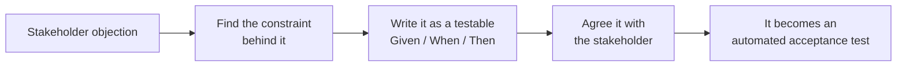

# Part 1 · Day 6 — Specs User Stories Acceptance Criteria & Turning Objections into Criteria

**Date completed:** 2026-11-23 · **Time spent:** ~7 hours

## Success criteria

| Criterion (copied from the planner) | Done? | Evidence (link or section below) |
| --- | --- | --- |
| Writes a lightweight outcome-focused PRD | Yes | [Exercise 1](#exercise-1-from-a-vague-ask-and-an-objection-to-a-sharp-prd) |
| Writes clear testable acceptance criteria | Yes | [Exercise 1, acceptance criteria](#acceptance-criteria) · [Exercise 4](#exercise-4-rewriting-weak-acceptance-criteria) |
| Writes a backlog item with outcome and value | Yes | [Exercise 2](#exercise-2-backlog-item-with-outcome-and-value) |
| Turns a constraint or objection into an acceptance criterion | Yes | [Exercise 3](#exercise-3-turning-objections-into-acceptance-criteria) · [Exercise 1](#exercise-1-from-a-vague-ask-and-an-objection-to-a-sharp-prd) |
| Completes the ATDD course sections | Yes | [ATDD course](#atdd-from-stories-to-executable-specifications) (all five sections complete, with a screenshot) |
| Reads both acceptance-criteria articles | Yes | [Acceptance criteria: the two articles](#acceptance-criteria-the-two-articles) · [Exercise 4](#exercise-4-rewriting-weak-acceptance-criteria) |

## Key learnings

### What a spec is for

*Source: The End of Requirements, Marty Cagan*

- **Stop thinking in "requirements."** Most of them aren't really requirements, and the rest are better treated as **constraints** (brand, legal, cost, distribution).
- **Define the product along two dimensions:**
  - **Unmet vs unrealized needs.** Unmet needs are problems customers already know about. Unrealized (latent) needs are ones they only notice once they see the solution.
  - **Customer-inspired vs technology-inspired solutions.**
- **Surveys and traditional market research only find unmet needs** as customers see them. They rarely lead to innovation.
- **Waterfall separates the problem space from the solution space.** Good teams knock that wall down. That's why PMs need to be more technical.
- **My conclusion on what a spec is for:** not a contract handed over the wall, but a **shared understanding of the outcome, the constraints and how we'll know it's done**. The acceptance criteria are the part that becomes a test.

### Acceptance criteria: the two articles

*Sources: How to use Acceptance Criteria (Sify / Kaiburr), Acceptance Criteria: From Theory to Practice (Product School)*

- **Acceptance criteria are the definition of "done" for one story.** They set its scope and describe *what* must be true, never *how* to build it.
- **They should cover:** existing features the story relies on, changed behaviour, checks, **negative scenarios, error handling**, outcomes, performance where relevant, and what's **out of scope** (Sify).
- **Good acceptance criteria are:** written from the user's view, specific, measurable, testable, simple, within the story's scope, and include edge cases. For example, "loads within 2 seconds," not "fast" (Product School).
- **Who writes them:** agreed together. The PM defines user-facing behaviour, and dev and ops can add technical standards (Sify).
- **Three formats:** rule-based (checklist), scenario-based (Given / When / Then), and hybrid, which is the most common for complex features.
- **Cost of weak criteria:** features that pass testing but miss the user's need, rework, scope creep and wasted spend.
- **In Scrum:** acceptance criteria guide estimation in Sprint Planning, contribute to "done," and are checked at the Sprint Review (Product School). They are *story-specific*, while the Definition of Done applies to *every* story (Day 3).

### Gherkin: Given, When, Then

*Source: Gherkin Reference (Cucumber)*

- **Structure:** `Feature` → optional `Rule` (one business rule) → `Example` or `Scenario` (a concrete example) → steps.
- **Given** is the starting state, written as something that already happened. No user actions here.
- **When** is the event or action.
- **Then** is an **observable** outcome, something the user or another system can see, not a database record.
- **Keep scenarios to 3–5 steps.** Use `Background` for shared Givens (4 lines at most) and `Scenario Outline` with `Examples` for the same behaviour with different data.
- **"Imagine it's 1922":** write steps without mentioning technology or UI. Implementation details belong in step definitions.
- **Use the domain's own language,** the words users and experts actually use.
- **Each example is a test,** so together the examples form an executable specification.

### ATDD: From Stories to Executable Specifications

*Source: Acceptance Testing: BDD From Stories to Executable Specifications (cd.training)*

I completed all five sections: Stories, Examples and Specifications (13/13), Effective Tests (9/9), Acceptance Testing as a Programming Language for AI (4/4), Test Infrastructure (8/8), and Test Strategy & Adoption (3/3), including the four review quizzes.


My key takeaways:

- **Testing done well drives development,** not just catches bugs, and it has to be automated to deliver that.
- **Most functional tests fail because they're too tightly linked to the system.** Acceptance testing breaks that link.
- **Good acceptance tests are concise, accurate, readable and durable.** You get all four by writing them in the **language of the problem domain**, not the language of the system being built.
- **The course runs from stories to examples to executable specifications,** using event storming and story mapping to understand the problem first.
- **Acceptance tests can act as the "programming language" for AI coding:** humans write the specification, and AI implements against it. This matches the "Tests as data" idea from Day 3.
- **On the infrastructure side,** a testing DSL and the Four Layer Model separate *what* is tested from *how* the system is driven, so tests survive UI and technical changes.

## Exercises

### Exercise 1: From a vague ask and an objection to a sharp PRD

**What I did:** took a vague ask and a stakeholder objection, and wrote both into a short, outcome-focused PRD with acceptance criteria. *Practice scenario, based on the analytics dashboard used on Days 4 and 5.*

**The vague ask (from a sales lead):** "Can we add AI insights to the dashboard? Competitors have it."

**The objection (from the finance lead):** "I'm not putting AI in front of executives if it can make up numbers. And our data only became reliable recently."

---

#### PRD: Weekly "What changed" summary

**Problem / opportunity**
Analysts spend time each week working out *what changed* in their KPIs before briefing their managers *(assumption, to be confirmed in interviews)*. "AI insights" is a solution in disguise. The opportunity is: *"I need to explain this week's changes quickly and correctly."*

**Outcome and success metric**
- **Product outcome:** analysts use the dashboard to prepare their weekly briefing.
- **Success metric:** share of weekly active analysts who open the summary, and time from opening the dashboard to sharing a briefing.
- **Guardrail:** zero reported cases of a summary number that doesn't match the dashboard.

**Users:** analysts who brief a manager weekly. Executives are *readers*, not the primary users.

**Type of need (Cagan):** an unrealized need with a technology-inspired solution. Analysts don't ask for summaries. They ask for "less prep time." So it must be validated before full build.

**Riskiest assumptions to test first (Day 4)**
1. Analysts would trust an AI-written summary *(desirability)*: prototype test with 5 analysts.
2. Summaries can avoid inventing numbers *(feasibility)*: research spike.
3. Finance will accept it with guardrails *(viability)*: review the acceptance criteria below with the finance lead.

**Scope**
- **In:** a weekly summary of the top KPI changes, each number linked to its dashboard source.
- **Out:** forecasts, recommendations, a chat interface, and executive-facing auto-emails.

**Constraints** (stakeholder concerns, turned into testable conditions below)
- Numbers in a summary must come from the dashboard, never be generated by the AI.
- Only KPIs with four clean weeks of data are summarized.
- Summaries must be clearly labelled as AI-generated.

#### Acceptance criteria

```gherkin
Feature: Weekly "What changed" summary
  Analysts get a short summary of this week's biggest KPI changes
  to help them brief their manager. Numbers must always match the dashboard.

  Background:
    Given Priya is an analyst who briefs her manager every Monday

  Rule: Every number in a summary matches the dashboard

    Example: Summary quotes a KPI change
      Given monthly revenue growth on the dashboard is +4.2%
      When Priya opens this week's summary
      Then the summary states revenue growth as +4.2%
      And the figure links to the revenue growth KPI on the dashboard

  Rule: Only KPIs with four clean weeks of data are summarized

    Scenario Outline: Data quality decides whether a KPI is included
      Given the "<kpi>" KPI has passed its data checks for <weeks> consecutive weeks
      When the weekly summary is prepared
      Then the "<kpi>" KPI is <result> in the summary

      Examples:
        | kpi            | weeks | result                                   |
        | Revenue growth | 4     | included                                 |
        | Churn rate     | 3     | listed as "not enough reliable data yet" |
        | Margin         | 0     | listed as "not enough reliable data yet" |

  Rule: Summaries are clearly marked as AI-generated

    Example: Summary label
      When Priya opens this week's summary
      Then she sees the label "AI-generated summary: check figures before sharing"

  Rule: The summary fails safely

    Example: Summary can't be produced
      Given the summary service is unavailable
      When Priya opens the dashboard
      Then she sees the dashboard as normal
      And she sees the message "This week's summary isn't available yet"
```

**Non-functional criteria (checklist)**
- [ ] Summary appears within 3 seconds of opening the dashboard
- [ ] Readable by screen readers, with each linked figure labelled

**My reasoning:** the objection became the most important rules in the spec. "Can make up numbers" became the first Rule, and "data only reliable recently" became the four-clean-weeks Scenario Outline, which mirrors the planner's own example. The finance lead's concern is now a test that passes or fails, not an argument.

### Exercise 2: Backlog item with outcome and value

**What I did:** turned the first slice of the PRD into a single backlog item, with outcome, value and acceptance criteria.

> **Title:** Show the top 3 KPI changes of the week, with numbers taken straight from the dashboard
>
> **User story:** As an analyst who briefs my manager every Monday, I want to see this week's three biggest KPI changes in one place, so that I can prepare my briefing in minutes instead of searching the whole dashboard.
>
> **Desired outcome:** analysts use the dashboard to prepare their weekly briefing.
> **Measure:** share of weekly active analysts who open this panel. Baseline to be set in the first two weeks.
>
> **Value:** saves analysts preparation time and builds trust. It's also the first, non-AI slice of the summary feature, so we learn whether analysts want it before investing in AI.
>
> **Acceptance criteria:**
> - Given revenue growth changed by the largest amount this week, when the analyst opens the dashboard, then revenue growth is shown first in "Top changes," with the same value as its KPI tile.
> - Given a KPI has fewer than four clean weeks of data, when "Top changes" is prepared, then that KPI is not included.
> - Given there are no changes this week, when the analyst opens the dashboard, then "Top changes" shows "No significant changes this week."
>
> **Out of scope:** AI-written text, alerts, exports.
> **Depends on:** automated calculation checks (Day 5, item C).

**My reasoning:** slicing out the AI part lets us test the riskiest *desirability* assumption cheaply. Do analysts want a "what changed" view at all? The AI writing comes only if they do.

### Exercise 3: Turning objections into acceptance criteria

**What I did:** took typical stakeholder objections, treated each as a constraint (Cagan), and rewrote it as a testable condition.

| Stakeholder | Objection | Constraint behind it | Testable acceptance criterion |
| --- | --- | --- | --- |
| Finance lead | "AI might make up numbers." | Accuracy | Every number in a summary equals the matching dashboard value and links to it. |
| Data lead | "The data isn't reliable yet." | Data quality | A KPI is summarized only after passing data checks for 4 consecutive weeks. |
| Legal / compliance | "Users might think it's official advice." | Liability | Every summary shows "AI-generated summary: check figures before sharing." |
| Engineering lead | "This will slow down the dashboard." | Performance | The dashboard loads in its usual time whether or not the summary is ready. The summary appears within 3 seconds. |
| Sales lead | "We need it before the next quarter." | Time | Not an acceptance criterion. It's a scheduling constraint, handled by slicing (Exercise 2). |



**My reasoning:** most objections hide a real constraint. Once it's written as a testable condition, the stakeholder can check the result instead of blocking the feature. The last row shows not every objection becomes an acceptance criterion. Deadlines are handled by scope.

### Exercise 4: Rewriting weak acceptance criteria

**What I did:** took weak criteria of the kind I've seen in vague tickets and rewrote them using the articles' rules and Gherkin's guidance.

| Weak criterion | What's wrong (per the articles) | Strong version |
| --- | --- | --- |
| "The dashboard should be fast." | Not measurable | "The dashboard loads within 2 seconds for 95% of visits." |
| "Show an error if something goes wrong." | No specific scenario, no observable outcome | "Given the data source is unavailable, when the analyst opens a KPI, then they see 'Data temporarily unavailable, last updated [time]'." |
| "Use a dropdown to choose the month." | Describes *how*, not *what* (breaks "imagine it's 1922") | "Given several months of data, when the analyst chooses a month, then all KPIs show values for that month." |
| "Then the summary is saved in the database." | Not observable by the user (Gherkin) | "Then the summary appears in the analyst's history." |
| "Export works." | No edge cases or out-of-scope | "Exports the current filtered view to Excel. An empty view exports headers only. PDF export is out of scope." |

## Reflection

What was new for me is Cagan's point that most "requirements" are really constraints, and the planner's idea that a constraint or objection can become an acceptance criterion. In Exercise 1, the finance lead's objection ended up shaping the most important rules of the spec, so the conversation moved from "should we?" to "here's the test it must pass." The ATDD course changed how I see acceptance criteria. Written in the language of the problem domain, they aren't just notes for QA but an executable specification, and with AI writing more code, they're becoming the main contract between people and the system. On my past KPI project, the calculation errors would have been caught by examples like the "+4.2%" rule if we had written them before building. In future, I'll write acceptance criteria as Given / When / Then examples before a story enters a Sprint, and I'll turn objections into criteria instead of treating them as blockers.

## AI use

- **Tools:** Claude.
- **Used for:**
  - structuring my notes into this template and drafting tables
  - drafting the PRD, backlog item and Gherkin scenarios from my chosen scenario
  - **generating the Mermaid diagram in Exercise 3**
  - combining my course-progress screenshots into one image
  - checking that every success criterion has evidence
- **What I checked and corrected:**
  - Checked the Gherkin against the Cucumber reference: keywords, Rule and Scenario Outline structure, observable Then steps, 3–5 steps per scenario and a short Background.
  - Checked the PRD's framing (constraints, not requirements, and unmet vs unrealized needs) against Cagan's article.
  - Labelled the dashboard scenario and all names and numbers as practice, not a live project.
  - The ATDD takeaways are based on the course and its two introductory lessons. The screenshot is my own progress.

## Open questions

1. At Incubyte, do product craftspeople write Gherkin scenarios directly, or co-write them with QA and developers in a "three amigos" session?
2. Is there an Incubyte PRD template, and how lightweight is it expected to be?
3. When a client stakeholder raises an objection like "four clean weeks of data," who signs off that the resulting acceptance criterion is right?

## Changes after review

- None yet.
