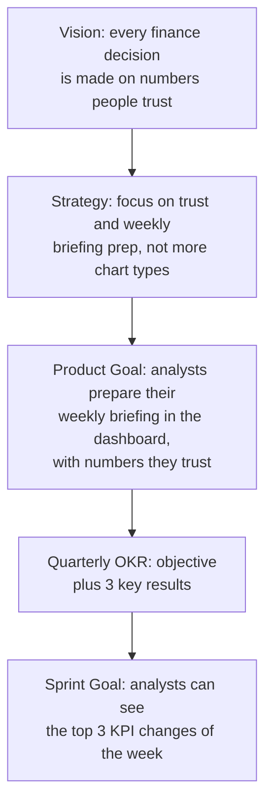
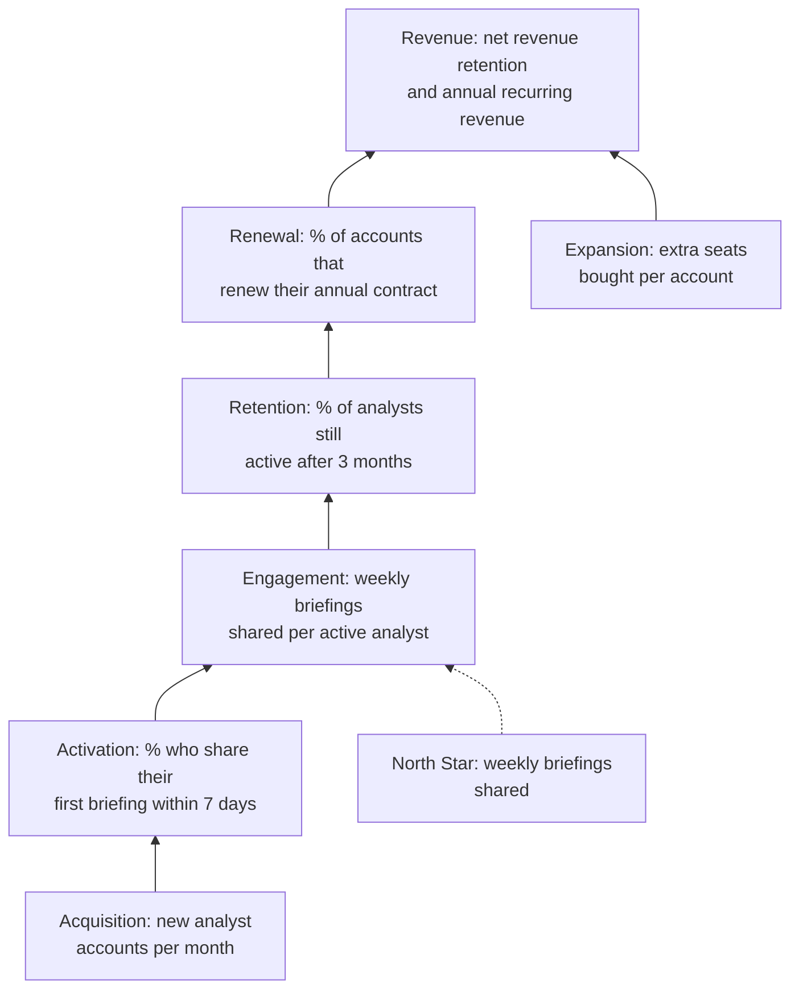

# Part 1 · Day 7 — Goal Setting Metrics Strategy & Product Economics

**Date completed:** 2026-11-27 · **Time spent:** ~5 hours

## Success criteria

| Criterion (copied from the planner) | Done? | Evidence (link or section below) |
| --- | --- | --- |
| Connects vision strategy outcomes and OKRs | Yes | [From vision to OKRs](#from-vision-to-okrs) · [Exercise 1](#exercise-1-from-vision-to-product-goal-to-okrs) |
| Explains the vision-to-product-goal relationship | Yes | [Vision and the Product Goal](#vision-and-the-product-goal) · [Exercise 1](#exercise-1-from-vision-to-product-goal-to-okrs) |
| Creates a product goal | Yes | [Exercise 1](#exercise-1-from-vision-to-product-goal-to-okrs) |
| Explains outcome vs output | Yes | [Outcome vs output](#outcome-vs-output) · [Exercise 5](#exercise-5-turning-outputs-into-outcomes) |
| Lists actions to maximize outcomes and minimize outputs | Yes | [Outcome vs output](#outcome-vs-output) · [Exercise 5](#exercise-5-turning-outputs-into-outcomes) |
| Defines product economics terms | Yes | [Product economics terms](#product-economics-terms) |
| Describes value from three stakeholder perspectives | Yes | [Exercise 4](#exercise-4-value-for-three-stakeholders-and-how-to-measure-it) |
| Knows techniques to measure value | Yes | [Measuring value](#measuring-value) · [Exercise 4](#exercise-4-value-for-three-stakeholders-and-how-to-measure-it) |
| Treats retention renewals monetization as first-class | Yes | [Beyond activation](#beyond-activation-retention-renewals-and-monetization) · [Exercise 3](#exercise-3-metric-tree-from-activation-to-revenue) |
| Defines North Star and guardrail metrics | Yes | [North Star and guardrails](#north-star-and-guardrails) · [Exercise 2](#exercise-2-north-star-with-guardrails-and-how-it-could-be-gamed) |
| Maps a metric tree end to end | Yes | [Exercise 3](#exercise-3-metric-tree-from-activation-to-revenue) |

## Key learnings

### From vision to OKRs

*Sources: Product Strategy Overview (Marty Cagan), What is an OKR (What Matters), Evidence-Based Management Guide (Scrum.org)*

- **Vision** is the change we want to make in the world. **Strategy** is *how* we'll make the vision real while meeting the needs of the business. **Tactics** are the details.
- **Cagan's split:** strategy decides *which problems* to solve, discovery finds solutions that work, and delivery builds them.
- **Strategy is hard because it needs four things:**
  - **focus:** a few choices, which means saying no to many
  - **insights:** from data, customers, technology and the market
  - **action:** giving teams objectives plus the strategic context
  - **active management** without micro-managing
- **The warning sign Cagan describes:** a company with a goal ("double revenue") and a roadmap of features, but no strategy in between, and 50 "top" objectives spread thinly across teams.
- **OKRs turn strategy into measurable goals:**
  - An **Objective** is *what* to achieve: significant, concrete, inspiring.
  - **3–5 Key Results** say *how we'll know*. They're specific, time-bound and verifiable, with no grey area.
  - Format: *"I will (Objective) as measured by (Key Results)."*
- **Three kinds of OKR:** **committed** (expected to be met), **aspirational** (stretch goals) and **learning** ("What's the most important thing to learn in 90 days?").
- **OKR vs KPI:** KPIs measure *health*. OKRs measure *change*. Common OKR mistakes are business as usual and sandbagging.
- **OKR benefits (Doerr's F.A.C.T.S.):** Focus, Alignment, Commitment, Tracking, Stretching.

### Vision and the Product Goal

*Sources: The Scrum Guide 2020 (Product Backlog section), EBM Guide*

- **The Product Goal sits in the Product Backlog.** It describes a **future state of the product** for the Scrum Team to plan against. The rest of the backlog emerges to define *what* will fulfil it.
- **The team pursues one Product Goal at a time** and must fulfil or abandon it before taking on the next.
- **How the pieces fit:** the vision is the long-term "why" for the whole product. The Product Goal is one concrete step toward it. Sprint Goals are steps toward the Product Goal.
- **EBM's three goal levels match this:** a **Strategic Goal** (far and uncertain), **Intermediate Goals** (signs we're on the path) and **Immediate Tactical Goals** (the current focus). Each step is a hypothesis we test and adapt.

### Outcome vs output

*Sources: EBM Guide, Product Strategy (Cagan), Day 4 (Torres)*

- **EBM's five kinds of measure:**
  - **Inputs:** what we spend, such as budget
  - **Activities:** what we do, such as meetings and coding
  - **Outputs:** what we produce, such as features and releases
  - **Outcomes:** what customers can now do or experience that they couldn't before
  - **Impacts:** what the organization gains, such as revenue and market share
- **Outputs are easy to measure, but outcomes are what matter.** More hours and more features don't mean better customer experiences.
- **Impact without customer outcomes isn't sustainable,** for example cutting quality to raise profit.
- **Every feature is a hypothesis about value** until customers confirm it. You often don't need to build all of it to test it.

**Actions a PO can take to maximize outcomes while minimizing outputs:**

1. **Start from an outcome or OKR, not a feature list.** Cagan: choose a few problems that matter.
2. **Test the riskiest assumptions before building** (Day 4). EBM: build only enough to validate the value.
3. **Ship the smallest valuable slice** to improve Time-to-Market and learn sooner.
4. **Limit what's in progress.** Fewer objectives get real focus, instead of a thin slice of 50.
5. **Remove or stop investing in low-value features.** EBM notes they quietly consume capacity and reduce the Ability to Innovate.
6. **Measure usage after release** (EBM's Customer Usage Index), and change or remove features nobody uses.

### Product economics terms

*Sources: EBM Guide (appendix), What Is Product Analytics (Amplitude). Some terms are from my wider reading, as marked.*

| Term | Meaning | Why it matters |
| --- | --- | --- |
| **Revenue per user / ARPU** | Average revenue from each user or account | Links behaviour to money (Amplitude) |
| **Lifetime value (LTV)** | Total revenue expected from a customer over their whole relationship | Shows what a retained customer is worth (Amplitude) |
| **Conversion-to-paid rate** | Share of free or trial users who become paying | A monetization lever (Amplitude) |
| **Product cost ratio** | All product costs, including operations, compared with revenue | Shows whether the product is economically healthy (EBM) |
| **Revenue per employee** | Gross revenue ÷ number of employees | An industry competitiveness indicator (EBM) |
| **Customer acquisition cost (CAC)** *(wider reading)* | Sales and marketing cost to win one customer | Compared with LTV: paying more to acquire than a customer is worth is a losing model |
| **Churn and renewal rate** *(wider reading)* | Share of customers who leave, or who renew, in a period | The key recurring-revenue metric for B2B products |
| **Net revenue retention (NRR)** *(wider reading)* | Revenue kept from existing customers after churn, downgrades and expansion | Above 100% means existing customers grow the business on their own |

### Measuring value

*Sources: EBM Guide, What Is Product Analytics (Amplitude), What is an OKR (What Matters)*

| Technique | What it measures |
| --- | --- |
| **EBM's four Key Value Areas** | **Current Value** (happiness of customers, employees and investors today), **Unrealized Value** (the gap still open), **Time-to-Market** (how fast we deliver and learn), **Ability to Innovate** (what stops us delivering new value) |
| **Product analytics** | Funnel, cohort, retention and path analysis, segmentation, and experimentation (A/B tests) on event-level user data |
| **North Star Metric** | One metric that captures the total value the product creates |
| **OKR grading** | Yes or no (Andy Grove), red / yellow / green, or a 0.0–1.0 score (Google) at the end of each cycle |
| **Satisfaction measures** | Sentiment from customers and employees (EBM Current Value) |

**EBM's balance point:** don't improve only internal speed (T2M, A2I) without watching customer value (CV, UV). That's a sign of missing outcome goals.

### Beyond activation: retention, renewals and monetization

*Source: What Is Product Analytics (Amplitude)*

- **Acquisition doesn't predict retention.** "Growth without activation is just expensive churn."
- **Early activation is the strongest predictor of retention.** 69% of top performers in 7-day activation were also top performers in 3-month retention. A 7% day-7 return rate puts a product in the top 25%.
- **The benchmarks are stark:** median 3-month retention is only 3.8%, and the top 10% reach 18.5%. Top-10% products also grow monthly active users about 7.5% per month, against under 1% for the median.
- **What I take from this:** activation is the start, not the finish line. For a B2B product, **retention leads to renewal, and renewal leads to revenue**, so each needs its own metric and owner, not just a sign-up count. Monetization metrics (LTV, conversion-to-paid) "close the loop" between behaviour and business value.

### North Star and guardrails

*Sources: The PM's guide to North Star Metrics (GoPractice), What Is Product Analytics (Amplitude)*

- **The North Star Metric (NSM)** captures the core value the product delivers to users and unites teams behind one goal. It also helps prioritize projects and spot changes that pull the team away from its mission.
- **GoPractice distinguishes two kinds of metric:**
  - **product metrics:** how individual users behave, such as retention rate
  - **growth metrics:** the total value created, such as DAU
- **The NSM must be a growth metric.** Retention rate can rise just by focusing on a smaller segment, without creating more total value.
- **Amplitude's examples:** "messages sent per week" for a messaging app, and "purchases per active buyer" for e-commerce.
- **Guardrail metrics** *(wider reading, matching the planner's definition)* are measures we commit *not* to harm while pushing the NSM: quality, trust, satisfaction and economics. They protect against gaming and opt-outs, and act as sanity checks.

## Exercises

*All exercises use the same practice scenario as Days 4–6: a B2B analytics dashboard sold to finance teams on annual contracts. All numbers are illustrative, not real data.*

### Exercise 1: From vision to product goal to OKRs

**What I did:** wrote the full chain for the dashboard, from vision down to a Sprint Goal.

| Level | Statement | Why it's at this level |
| --- | --- | --- |
| **Vision** | Every finance decision is made on numbers people trust. | The change we want in the world. Long-lived and not measurable on its own. |
| **Strategy** (Cagan) | **Focus:** trust and weekly briefing prep. **Not now:** new chart types or a mobile app. **Insight:** calculation errors and prep time were the biggest pain (Days 4–5). | Says which problems to solve, and which not |
| **Product Goal** | Analysts prepare their weekly briefing in the dashboard, using numbers they trust. | A future state of the product, in the Product Backlog. One at a time. |
| **OKR (committed, this quarter)** | **O:** make the dashboard the trusted place to prepare weekly briefings. **KR1:** weekly analysts who share a briefing from the dashboard rise from 30% to 45%. **KR2:** zero reported calculation errors. **KR3:** 3-month retention of new analyst accounts rises from 40% to 50%. | Measurable change, not health. Each KR is a clear yes or no. |
| **Learning OKR** | **O:** understand why analysts leave the dashboard to prepare briefings elsewhere. **KR:** 8 story-based interviews completed, and the opportunity solution tree updated. | Matches the Day 4 discovery gap |
| **Sprint Goal** | Analysts can see the top 3 KPI changes of the week (Day 6 backlog item). | One step toward the Product Goal |

**Checking the Product Goal:** it describes a future state (not a feature), it can be fulfilled or abandoned, and the backlog items from Days 5 and 6 all serve it.

### Exercise 2: North Star with guardrails, and how it could be gamed

**What I did:** defined a North Star for the dashboard, added guardrails, then listed how it could be gamed and which guardrail catches each.

**North Star Metric:** *number of weekly briefings shared from the dashboard*

- **It's a growth metric,** a total count that rises with more analysts *and* more value per analyst, as GoPractice requires.
- **It reflects the core value:** an analyst trusted the numbers enough to brief their manager with them.

**Guardrail metrics:**

| Guardrail | Threshold | What it protects |
| --- | --- | --- |
| Reported calculation errors | 0 per month | Trust and accuracy |
| Summary numbers matching the dashboard | 100% (Day 6 acceptance criteria) | Prevents the AI summary from inventing numbers |
| Notification opt-out rate | Under 5% per month | Prevents growth by spamming |
| Briefings actually opened by the recipient | 60% or more | Real value, not empty sends |
| 3-month account retention | Not below the current level | Long-term value |
| Dashboard load time | 2 seconds or less for 95% of visits | Experience quality |

**How the North Star could be gamed, and the guardrail that catches it:**

| Way to game it | What would happen | Guardrail that catches it |
| --- | --- | --- |
| Auto-share a briefing every week by default | Shares jump, nobody reads them | Briefings opened by the recipient |
| Push frequent "share now" reminders | Short-term rise, then users mute notifications | Notification opt-out rate |
| Count each re-send or edit as a new share | Inflated count with no new value | Define the metric as unique briefings per analyst per week |
| Ship the AI summary before data checks are in | Faster shares, wrong numbers | Calculation errors and summary-match rate |
| Focus only on power users | NSM rises while most accounts quietly churn | 3-month account retention |

**My reasoning:** every way to game the North Star raises the number without raising real value. Each guardrail measures the value the gaming would destroy. Opt-outs are their own guardrail because they show users rejecting the product's nudges.

### Exercise 3: Metric tree from activation to revenue

**What I did:** mapped the dashboard's metrics end to end, from first use to revenue, with each stage driving the next.

| Stage | Metric | Leading or lagging | How I'd analyse it (Amplitude) | Illustrative target |
| --- | --- | --- | --- | --- |
| Acquisition | New analyst accounts per month | Leading | Segment by channel: which channels bring analysts who *activate*? | Steady, not the focus |
| Activation | % sharing a first briefing within 7 days | Leading, the strongest predictor of retention | Funnel: open → view KPI → share | 30% → 40% |
| Engagement | Weekly briefings per active analyst | Leading | Cohort analysis by signup month | 1.5 per week |
| Retention | % active after 3 months | Lagging for activation, leading for renewal | Retention curves (N-day or bracket) | 40% → 50% |
| Renewal | % of accounts renewing | Lagging | Accounts with falling weekly usage flagged 90 days before renewal | 90% |
| Expansion | Extra seats per account | Lagging | Segment by team size | More than 0 for 20% of accounts |
| Revenue | Net revenue retention | Lagging (impact) | Combines renewal, expansion and churn | Over 100% |

**My reasoning:** treating retention, renewal and monetization as first-class means each stage has its own metric, target and analysis, not just a sign-up count at the top. The North Star sits at engagement because that's where the user's value happens. Revenue follows from it.

### Exercise 4: Value for three stakeholders, and how to measure it

**What I did:** described what "value" means for different stakeholders, and matched each to a way to measure it. The first three come from EBM's Current Value questions. I added the client, since Incubyte builds for clients.

| Stakeholder | What value means to them | How to measure it | EBM Key Value Area |
| --- | --- | --- | --- |
| **Customers / users** (analysts) | Brief their manager faster, with trusted numbers | Weekly briefings shared, prep time, satisfaction survey | Current Value (customer satisfaction, usage index) |
| **Employees** (the team building it) | Work that matters, without endless firefighting | Employee engagement, time spent on production incidents, on-product index | Current Value and Ability to Innovate |
| **Investors / business owners** | Sustainable revenue and healthy margins | NRR, product cost ratio, LTV ÷ CAC | Current Value (impact) |
| **Client** (for an Incubyte pod) | Faster, reliable delivery of what moves their business | Lead time, release frequency, change failure rate | Time-to-Market and Ability to Innovate |

**My reasoning:** the same feature can create value for one group and cost another. For example, an AI summary shipped too early pleases sales but erodes user trust. Looking from several perspectives shows those trade-offs.

### Exercise 5: Turning outputs into outcomes

**What I did:** took features from my Day 5 list, rewrote each as the outcome it should create, and named the smallest output that might achieve it.

| Output (feature) | Outcome it should create | How we'd know | Smallest output to test it |
| --- | --- | --- | --- |
| Calculation explainer | Analysts trust the numbers enough to brief with them | More briefings shared, fewer "is this right?" tickets | A tooltip on the top 3 KPIs |
| Excel export | Analysts stop using screenshots and workarounds | Fewer screenshot-based support tickets | Export of the current view only |
| Custom KPI builder | Analysts can answer their manager's specific questions | Fewer requests for one-off reports | Saved, shareable filtered views (Day 5) |
| AI "what changed" summary | Briefing prep takes minutes, not an hour | Prep time measured in a survey | Non-AI "top 3 changes" panel (Day 6) |

**My reasoning:** each row starts from a feature and ends with a much smaller output that can test the same outcome. That's how to maximize outcomes while minimizing outputs.

## Reflection

What was new for me is how clearly the EBM guide separates outputs, outcomes and impacts. It made me notice that many past "success" measures I've seen were really outputs, like features shipped or KPIs delivered. Cagan's point that most companies have a goal and a roadmap but no strategy in between also landed: strategy is the choice of *which* problems to solve, and that means saying no. The Amplitude data changed my view of activation. It isn't the finish line but the strongest early signal for retention, which in a B2B product leads to renewal and revenue. Designing the North Star exercise showed me that any single metric can be gamed, so guardrails aren't optional extras. In future, I'll write the outcome and its guardrails before agreeing a feature, and I'll keep retention and renewal metrics in front of the team, not just activation.

## AI use

- **Tools:** Claude.
- **Used for:**
  - structuring my notes into this template and drafting tables
  - drafting the vision → OKR chain, North Star, guardrails and metric tree from my chosen scenario
  - **generating both Mermaid diagrams** (the goal chain in Exercise 1 and the metric tree in Exercise 3)
  - checking that every success criterion has evidence
- **What I checked and corrected:**
  - Checked the Product Goal definition against the Scrum Guide's Product Backlog section, and the OKR format, types and grading against What Matters.
  - Checked that the North Star is a *growth* metric, not a product metric, as GoPractice requires.
  - Checked the Amplitude benchmark figures against the article.
  - Labelled CAC, churn and renewal rate, NRR and the term "guardrail metric" as wider reading.
  - Labelled the scenario and all targets as illustrative.

## Open questions

1. For client products, who owns the North Star and OKRs: the client's product leadership, or the pod's product craftsperson?
2. Do Incubyte pods use EBM's Key Value Areas (such as Time-to-Market and Ability to Innovate) to show clients the value of craft practices?
3. How do pods get access to clients' product analytics and revenue data to track metrics like retention and renewal?

## Changes after review

- None yet.
