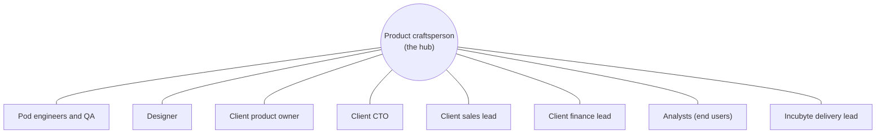

# Part 1 · Day 8 — Stakeholder Management Influence & Commercial Thinking

**Date completed:** 2026-11-28 · **Time spent:** ~4 hours

## Success criteria

| Criterion (copied from the planner) | Done? | Evidence (link or section below) |
| --- | --- | --- |
| Understands the PM as a cross-functional hub | Yes | [The PM as a hub](#the-pm-as-a-hub) · [Exercise 2](#exercise-2-stakeholder-map) |
| Owns the persuasion rather than deferring | Yes | [Influence without authority](#influence-without-authority) · [Exercise 1](#exercise-1-written-case-for-a-decision-some-stakeholders-will-dislike) |
| Knows techniques to gather stakeholder insights | Yes | [Gathering stakeholder insights](#gathering-stakeholder-insights) · [Exercise 3](#exercise-3-insight-gathering-plan) |
| Manages up and client expectations | Yes | [Managing up and client expectations](#managing-up-and-client-expectations) · [Exercise 5](#exercise-5-one-piece-of-news-internal-vs-external) |
| Understands pricing GTM and unit economics at a working level | Yes | [Commercial thinking](#commercial-thinking) · [Exercise 4](#exercise-4-pricing-pilot-to-contract-and-unit-economics) |
| Drafts and owns a written case for a hard decision | Yes | [Exercise 1](#exercise-1-written-case-for-a-decision-some-stakeholders-will-dislike) |

## Key learnings

### The PM as a hub

*Sources: Influence Without Authority (Product School), Stakeholder Management (ProductPlan), Why PMs Need Business Acumen*

- **The PM brings together engineers, designers, data people and business teams without being anyone's boss.** "With great responsibility comes no power."
- **Stakeholders** are anyone who can affect, or is affected by, the product.
  - **Upstream** stakeholders design, build or approve it.
  - **Downstream** stakeholders buy, use, sell, market or support it.
- **What stakeholders have in common:** influence, a connection to product decisions, power (something the PM needs, such as approval, budget or information) and irreplaceability.
- **Each function feels different pressures:**
  - sales: deal blockers and competitors
  - finance: return on investment
  - marketing: positioning
  - customer success: retention and adoption
  - leadership: strategic outcomes
- **A good hub speaks each function's language.**
- **In a consulting pod** (Day 1), the hub also spans the client: their product owner, technical leaders, business sponsors and end users, as well as Incubyte's own delivery side.

### Influence without authority

*Sources: Influence Without Authority (Product School), Product Evangelism (Marty Cagan)*

**Seven ways to build influence (Product School):**

1. Always bring the data.
2. Show you're listening.
3. Build a personal brand and credibility.
4. Keep everything tied to the vision.
5. Appeal to each side's self-interest, and look for a compromise that serves both.
6. Embrace resistance. *They might be right*, or you get the chance to show why they're wrong.
7. Explain your "why."

**Influence builds over time** through a track record. You lose it by interrupting, reacting badly to criticism, or manipulating people. Influence earns respect; manipulation treats people as puppets.

**Cagan's evangelism ("selling the dream"):**

- build a high-fidelity prototype
- share the customer's pain (bring stakeholders to user tests)
- share the vision
- share learnings and credit generously, and take the blame when things go wrong
- give a great demo (not training, and not a test)
- do your homework, so you're the expert on users and the market
- be genuinely, visibly excited, and spend time with the team

**What "owning the persuasion" means to me:** keep making a well-reasoned case with evidence, rather than giving in the first time someone senior disagrees. That includes:

- **preparing in advance:** previewing the case with key decision-makers before the meeting (ProductPlan, Day 5)
- **asking what evidence would change their mind,** and proposing a cheap test
- **making the final decision explicit and written down,** even if it goes against me

Accepting the decision isn't the same as giving up on the argument. If it's overruled, I commit to the decision openly and agree a measurable checkpoint where we revisit it.

### Gathering stakeholder insights

*Sources: Stakeholder Management (ProductPlan), Influence Without Authority (Product School), Product Evangelism (Cagan), Why PMs Need Business Acumen*

| Technique | What it gives me |
| --- | --- |
| **Stakeholder analysis:** identify, then prioritize on a power / interest grid, then profile | Who matters most and how to engage them. High power and high interest means fully engaged. |
| **A profile with three questions:** what motivates them, how this fits their priorities, and whether they see the project negatively | Their real concerns, before they turn into objections |
| **1:1s with active listening:** questions, follow-ups and notes | Trust, and concerns people won't raise in groups |
| **Team brainstorms and shared idea documents** | Ideas and buy-in from people who feel heard |
| **Bringing stakeholders to user tests** (Cagan) | A shared view of the customer's pain |
| **Sitting with sales and customer success; asking finance how success is measured** | Commercial realities, objections and retention risks |
| **Reading earnings reports, investor decks and competitor positioning** | The business's priorities and pressures |

### Managing up and client expectations

*Sources: Stakeholder Management (ProductPlan), Why PMs Need Business Acumen, Independent Pods and Values in Action (Day 1)*

- **Managing up means speaking leadership's language.** Not "customers are asking for this," but "customers representing 28% of expansion revenue have raised this repeatedly."
- **Good stakeholder management manages expectations** and *reduces the urge to micromanage*. Each stakeholder gets a communication plan suited to them (face to face, weekly email, and so on).
- **For a client (Day 1):**
  - be "one team" with them
  - take a consulting mindset: make offers, not just take orders
  - share short, regular updates
  - escalate risks early, with a suggested fix
  - be open about mistakes
  - hold quarterly goal reviews and send a Monthly Readout
- **The habit I'm building:** no surprises. Bad news goes up early, with options, and never first appears in a status report.

### Separating external from internal communication

*Sources: Product Roadmaps (ProductPlan, Day 5), Stakeholder Management (ProductPlan)*

- **Internal:** candid and detailed. Uncertainty, risks, estimates and open debates are visible to the team.
- **External** (customers, the market, sometimes client sponsors): focused on benefits, committed items only, and **no release dates unless certain**.
- **A known risk:** sales sharing an internal roadmap with customers can commit the team to dates it never agreed.
- **Being deliberate means** writing the external version separately, not forwarding the internal one.

### Commercial thinking

*Source: Why PMs Need Business Acumen. Some terms are from my wider reading, as marked.*

- **Every product decision has a business consequence.** For example, pricing changes revenue, a delay affects retention, and poor onboarding raises acquisition cost.
- **Business acumen at a working level means understanding:**
  - revenue mechanics (subscription, transactions, enterprise contracts, advertising, usage-based)
  - unit economics (CAC, LTV, contribution margin, retention economics)
  - market positioning
  - which customer segments drive value
  - the company's current strategic priority
- **Questions owners ask:** Is this worth investing in? What metric moves? What's the opportunity cost? What happens if we do nothing?
- *Wider reading:*
  - **Pricing approaches:** per seat, tiered, usage-based, value-based, freemium.
  - **Go-to-market (GTM):** who we sell to, how we reach them (sales-led or product-led) and how we position against competitors.
  - **Pilot-to-contract:** a time-boxed paid pilot with success criteria agreed up front. Meeting them converts it into a full contract.

## Exercises

*Practice scenario, continuing from Days 4–7: a B2B analytics dashboard sold to finance teams. Names and numbers are illustrative.*

### Exercise 1: Written case for a decision some stakeholders will dislike

**What I did:** wrote a one-page decision memo for a decision the sales lead and one client executive won't like, then planned how to own the argument.

---

> **Decision memo: Launch "Top 3 changes" first. Hold the AI summary until data checks pass four clean weeks.**
>
> **Decision:** this quarter we ship the non-AI "Top 3 changes" panel. The AI "What changed" summary is held until every summarized KPI has passed automated calculation checks for four consecutive weeks. Our current estimate is late next quarter.
>
> **Why now:** sales wants the AI summary this quarter to match a competitor. I understand the pressure. The issue is that our calculation checks went live only two weeks ago.
>
> **Options considered**
>
> | Option | Upside | Risk |
> | --- | --- | --- |
> | A. Ship the AI summary now | Matches the competitor in sales demos | A wrong number in front of an executive damages trust, our North Star value (Day 7), and renewals |
> | **B. Ship "Top 3 changes" now, the AI summary after four clean weeks (recommended)** | Delivers most of the value (faster briefing prep) safely, and tests whether analysts want a "what changed" view at all | Sales lacks an AI headline for about one quarter |
> | C. Do neither, and wait | No risk | Loses the opportunity and the learning |
>
> **Evidence:** our own history: calculation errors were the biggest trust problem (Days 4–5). The guardrail of zero calculation errors is a committed key result (Day 7). The AI summary is also a technology-inspired solution to an *unrealized* need (Day 6), so we don't yet know analysts want it.
>
> **What we give up:** an AI story in demos this quarter. To soften this, sales gets a short demo of the AI prototype labelled "coming next," **with no date**.
>
> **What would change my mind:** if three or more named deals are blocked by the missing AI summary, or if the data checks pass early.
>
> **Ask:** agree option B by Friday. I'll review it with sales at the four-week checkpoint.

---

**Owning the argument:**

| Step | What I'll do |
| --- | --- |
| Before the meeting | Preview the memo 1:1 with the sales lead and the finance lead. Hear their objections privately first. |
| Appeal to self-interest | For sales: a wrong number in a client demo would cost more deals than a missing feature. They also get a safe "coming next" demo. |
| Embrace resistance | Ask sales for the specific deals at risk. If the evidence is strong, I'll reconsider. That's my stated "change my mind" condition. |
| If I'm overruled | Commit openly. Ask for one condition: a summary is shown only for KPIs that have passed their checks (Day 6 acceptance criterion). Record the decision and the risk, and agree to review it in four weeks. |
| Afterwards | Share the results, good or bad, and the credit with the team. |

**My reasoning:** the memo states what we give up and what would change my mind, so it reads as a reasoned position, not stubbornness. The "if overruled" row is the difference between owning the persuasion and just deferring.

### Exercise 2: Stakeholder map

**What I did:** mapped the stakeholders around the pod's product craftsperson, then placed them on ProductPlan's power / interest grid and profiled them.

| Stakeholder | Power | Interest | Approach | What motivates them | Possible negative view |
| --- | --- | --- | --- | --- | --- |
| Client product owner | High | High | **Manage closely:** weekly 1:1, shared backlog | Hitting the product goal | Fear of losing control to the pod |
| Client CTO | High | Medium | **Keep satisfied:** monthly readout, quality metrics | Stability and engineering cost | Worry about AI risk |
| Client sales lead | Medium | High | **Keep informed:** demos, "coming next" updates | Closing deals | Sees quality-first as "slow" |
| Client finance lead | High | Medium | **Keep satisfied:** involve in guardrails | Accurate numbers, return on investment | Distrust of AI-generated numbers |
| Analysts (end users) | Low (individually) | High | **Keep informed and involved:** interviews, prototype tests | Faster, trusted briefings | Change fatigue |
| Incubyte delivery lead | Medium | Medium | **Keep informed:** internal updates | Pod health, client happiness | Pod over-stretched |

### Exercise 3: Insight-gathering plan

**What I did:** chose which technique I'd use with each stakeholder to understand their real concerns before the AI summary decision.

| Stakeholder | Technique | Question I'd ask |
| --- | --- | --- |
| Client sales lead | Sit in on two sales calls | "Which objections come up most, and is AI one of them?" |
| Client finance lead | 1:1 with active listening | "What would make you comfortable with an AI summary in front of executives?" |
| Client CTO | Review incident data, then a 1:1 | "What has caused the most production incidents this year?" |
| Analysts | Story-based interviews (Day 4) | "Tell me about the last time you prepared a weekly briefing." |
| Pod engineers | Team brainstorm and shared doc | "What's the riskiest part of the AI summary to build?" |

### Exercise 4: Pricing, pilot-to-contract and unit economics

**What I did:** worked through the commercial side of the dashboard at a working level. *All figures are illustrative.*

**Pricing approach:** per seat ($40 per analyst per month) on an annual contract. It's simple for finance buyers and grows with team size, which supports expansion (Day 7 metric tree). Usage-based pricing was rejected because analysts would ration their use, which harms the North Star.

**Unit economics for a typical 25-seat account:**

| Measure | Calculation | Result |
| --- | --- | --- |
| Annual recurring revenue (ARR) | $40 × 25 seats × 12 | $12,000 |
| Gross profit | ARR × 80% gross margin | $9,600 per year |
| Expected customer lifetime | 1 ÷ (1 − 85% annual renewal) | about 6.7 years |
| Lifetime value (LTV) | $9,600 × 6.7 | about $64,000 |
| Customer acquisition cost (CAC) | Sales and marketing cost per account | $15,000 |
| LTV ÷ CAC | $64,000 ÷ $15,000 | about 4.3 |
| CAC payback | $15,000 ÷ ($9,600 ÷ 12) | about 19 months |
| AI summary running cost | $0.05 × 25 analysts × 52 weeks | $65 per year (about 0.5% of ARR) |

**What it tells me:**

- **The model is healthy on paper,** but a 19-month payback means a customer who churns in year one costs more to win than they ever pay. That's why **renewal**, not sign-ups, is the commercial priority.
- **The AI feature's running cost is tiny.** Its real commercial risk is **trust**: one wrong number could cost a renewal worth about $12,000 a year.

**Pilot-to-contract plan for a new client:**

| Stage | What happens | Exit criterion (written as a testable condition, Day 6) |
| --- | --- | --- |
| 1. Paid pilot (6 weeks, 1 team) | Dashboard set up for one finance team | 60% of pilot analysts share a weekly briefing in 4 of the 6 weeks, with zero calculation errors |
| 2. Review | Results shared with the client sponsor | Sponsor agrees the criteria were met |
| 3. Contract | Annual per-seat contract for the department | Signed, with the pilot fee credited |

**My reasoning:** agreeing the exit criteria *before* the pilot turns "do you like it?" into a pass or fail test, the same idea as turning objections into acceptance criteria.

### Exercise 5: One piece of news, internal vs external

**What I did:** wrote the same news (the AI summary is delayed) twice: once for the internal team and once for the client's wider stakeholders. That covers both managing up and separating the two audiences deliberately.

| | Internal (pod and Incubyte channel) | External (client sponsor and their stakeholders) |
| --- | --- | --- |
| **Message** | "We're holding the AI summary. Data checks have only 2 clean weeks, and we need 4. Risk: the checks for churn rate keep failing. Owner: me. Next check: Friday. Sales pressure is high, and I'm handling it." | "This quarter we're delivering 'Top 3 changes,' which gives your analysts a faster weekly briefing. The AI summary comes next, once every number in it has been verified. We'll share progress at the monthly review." |
| **Includes** | Exact status, risks, owners, internal tensions | Benefits, what's committed, how quality is protected |
| **Leaves out** | Nothing that matters to the team | Internal estimates, dates and team debates |

**My reasoning:** the external version isn't less honest. It's the same truth at the right level of detail for that audience, as Day 1's "work in public" principle says, and with no date we can't keep.

## Reflection

At Occams Advisory, while planning the KPI expansion for CFO Insights AI, I proposed shipping the seven new financial KPIs in small batches, each checked against expected values before release. Leadership preferred to launch all seven together as one announcement, and I accepted that after a single discussion. The result was one large financial-math QA pass at the end, which caught several calculation errors late: exactly the risk I'd been worried about. Looking back, I deferred too quickly. I raised the concern, but I didn't bring data, didn't preview my case 1:1 with the decision-makers, and didn't offer a compromise, such as announcing all seven together while building and verifying them in batches behind the scenes. Owning the persuasion would have meant a short written case with options, what we'd give up and a checkpoint. If I'd still been overruled, I'd have asked for one condition: expected values agreed for every KPI before building. That experience is why I introduced the financial-math QA process there, and why I now write the case down instead of arguing it once in a meeting.

## AI use

- **Tools:** Claude.
- **Used for:**
  - structuring my notes into this template and drafting tables
  - drafting the decision memo, stakeholder map and internal/external messages from my chosen scenario
  - **generating the Mermaid stakeholder diagram in Exercise 2**
  - calculating the unit economics
  - checking that every success criterion has evidence
- **What I checked and corrected:**
  - Checked the influence techniques against Product School, the stakeholder steps against ProductPlan, and the evangelism advice against Cagan.
  - Re-checked every unit-economics figure.
  - Labelled pricing models beyond the article, GTM, pilot-to-contract and "disagree and commit"-style thinking as wider reading.
  - Labelled the scenario and all numbers as illustrative.
  - The reflection is based on my own experience at Occams Advisory. Claude drafted the wording from my resume, and I corrected it to match what actually happened.

## Open questions

1. In a client engagement, when the client's sales lead and product owner disagree, who has the final say on scope: the client PO, or a joint decision with the pod?
2. Does Incubyte have a standard format for decision memos or written cases shared with clients?
3. How much commercial data (pricing, revenue, CAC) do clients usually share with pods?

## Changes after review

- None yet.
