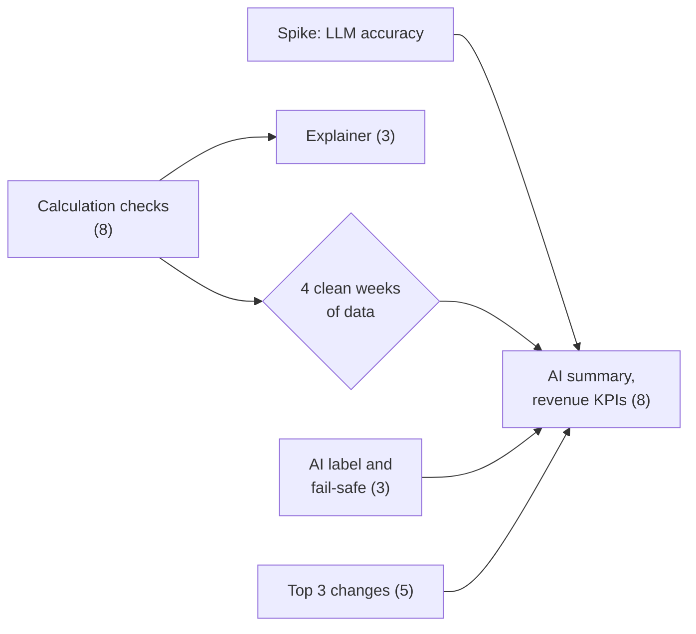

# Part 1 · Day 9 — Agile Delivery Planning Backlog & Working with an XP Team

**Date completed:** 2026-11-28 · **Time spent:** ~5 hours

## Success criteria

| Criterion (copied from the planner) | Done? | Evidence (link or section below) |
| --- | --- | --- |
| Manages backlog and refinement | Yes | [Backlog and refinement](#backlog-and-refinement) · [Exercise 1](#exercise-1-a-product-backlog-for-a-product-goal) |
| Creates a backlog supporting a product goal | Yes | [Exercise 1](#exercise-1-a-product-backlog-for-a-product-goal) |
| Writes a backlog item with outcome and value | Yes | [Exercise 2](#exercise-2-backlog-item-and-sprint-goal) |
| Creates a sprint goal | Yes | [Exercise 2](#exercise-2-backlog-item-and-sprint-goal) · [Exercise 4](#exercise-4-size-the-backlog-and-plan-the-sprint) |
| Lists components of a product plan or forecast | Yes | [Product plans, forecasts and releases](#product-plans-forecasts-and-releases) · [Exercise 5](#exercise-5-release-plan-forecast-and-transparency) |
| Plans a product release | Yes | [Exercise 5](#exercise-5-release-plan-forecast-and-transparency) |
| Identifies small valuable increments | Yes | [Small valuable increments](#small-valuable-increments) · [Exercise 3](#exercise-3-slicing-into-small-valuable-increments) |
| Uses a technique for stakeholder transparency on progress | Yes | [Exercise 5](#exercise-5-release-plan-forecast-and-transparency) (release burn-up chart) |
| Estimates with story points | Yes | [Story points](#story-points-estimates-are-forecasts-not-promises) · [Exercise 4](#exercise-4-size-the-backlog-and-plan-the-sprint) |
| Uses velocity to forecast and distinguishes it from capacity | Yes | [Velocity vs capacity](#velocity-vs-capacity) · [Exercise 4](#exercise-4-size-the-backlog-and-plan-the-sprint) |
| Sequences competing work | Yes | [Exercise 4](#exercise-4-size-the-backlog-and-plan-the-sprint) |
| Understands delivery inside an XP team | Yes | [Delivery inside an XP team](#delivery-inside-an-xp-team) · [Exercise 6](#exercise-6-what-changes-when-engineers-pair-and-test-first) |

## Key learnings

### Backlog and refinement

*Sources: What Is a Product Backlog in Scrum? (Scrum Alliance), Backlog Refinement Guide (Atlassian)*

- **The Product Backlog is the team's single, ordered, emergent list of work toward the Product Goal.** It should change as we learn.
- **The PO is accountable for it.** Stakeholders bring requests to the PO, not to team members, and the PO's "no" should be respected across the organization.
- **It's shaped like an iceberg:** small, ready items at the top, and large, vague ones at the bottom.
- **Each item should deliver value on its own.** "The tool can cut wood" is a good item. "Build it" or "Get approval" are tasks, not items.
- **Not every item has to be a user story.** Mixing stories with other items is fine.
- **Two kinds of refinement (Scrum Alliance):**
  - **strategic:** whenever the PO discusses new features, changes or removals
  - **tactical:** the team adds detail and splits large items
- **Refinement is ongoing (Atlassian),** usually in a recurring session of about 30 minutes before each Sprint Planning.
  - The PO runs it, with at least one developer and one QA present.
  - Near-term items are fully refined, with stories, design input and estimates. Long-term items can stay rough.
  - "Grooming" and "refinement" mean the same thing.
- **Enough detail for a conversation,** not a full specification. The team relies on the PO understanding the desired outcome.

### Product plans, forecasts and releases

*Sources: Product Release Guide (Atlassian), Story Points (teachingagile), Velocity (monday.com)*

**Components of a product plan or forecast:**

1. **Goal:** the Product Goal and release objectives
2. **Scope:** the ordered backlog items in the release
3. **Size:** story-point estimates from the Developers
4. **Pace:** a velocity *range* (best, average, worst), not a single number
5. **Capacity:** availability in upcoming Sprints
6. **Dependencies and risks**
7. **Milestones:** releases and checkpoints
8. **Assumptions and confidence**
9. **Buffer:** many teams plan at about 80% of estimated capacity

**A release (Atlassian)** is a technical deployment and availability. A **launch** is the higher-profile marketing event. **The phases of a release:**

1. **Planning and strategy:** research, roadmap, minimum viable scope
2. **Development and testing:** with CI/CD and frequent testing
3. **Deployment:** a readiness review, then a **phased rollout** or a "big bang," plus a way to capture feedback
4. **After release:** monitoring, support and feedback for the next iteration

**Common release challenges:** balancing speed and quality, dependencies, rollback plans, and aligning cross-functional teams.

### Small valuable increments

*Sources: Scrum Alliance, teachingagile, Day 4 (story mapping), Day 6 (slicing)*

- **Split along functional boundaries, so each slice works on its own.** Never split into "frontend" and "backend" halves (teachingagile).
- **Approaches I use:**
  - **by workflow step** (a story map: walk the user's steps and ship one step end to end)
  - **by business-rule or data variation** (one KPI first, then the rest)
  - **by user segment**
  - **a non-AI first slice before the AI version** (Day 6)
  - **happy path first, edge cases next**
- **Split threshold:** many teams split anything estimated at 13 points or more before it enters a Sprint.

### Story points: estimates are forecasts, not promises

*Source: Story Points in Agile (teachingagile)*

- **Story points measure relative size:** effort, complexity and uncertainty together. Not hours, not individual productivity, and not business value.
- **They aren't in the Scrum Guide.** They're a complementary practice.
- **Common scale:** Fibonacci (1, 2, 3, 5, 8, 13, 21). Wider gaps reflect less precision for bigger items.
- **Use reference stories** as the ruler, estimate by comparison, and discuss outliers instead of averaging.
- **Only Developers estimate.** The PO presents and answers questions but never suggests a number, which would anchor the team (mistake #6).
- **Mistakes to avoid:**
  - converting points to hours
  - comparing velocity across teams
  - using points to judge individuals
  - pointing bugs (better: reserve some capacity for them)
  - never re-estimating
  - setting velocity targets (Goodhart's law: a measure that becomes a target stops being a good measure)

### Velocity vs capacity

*Sources: Velocity (monday.com), Story Points (teachingagile), Definition of Done (Agile Alliance)*

| | Velocity | Capacity |
| --- | --- | --- |
| Looks | Backward: what we completed | Forward: how much time we have |
| Unit | Story points | Hours or days |
| Used for | Forecasting and sizing a Sprint | Adjusting for leave, holidays and meetings |

- **Only work that meets the Definition of Done counts.** A 90%-done story counts as zero.
- **Use 3–5 Sprints for a baseline.** Forecast with a range.
- **Velocity is descriptive, not a target.** It's never a measure of individual performance.
- **A new joiner** typically runs at 50–70% of normal velocity while ramping up (monday.com).

### Delivery inside an XP team

*Sources: Definition of Done (Agile Alliance), Day 3 (XP, TDD, CI), teachingagile*

- **The Definition of Done** is a visible, explicit checklist, the *minimum* for every increment. Work that doesn't meet it doesn't count toward velocity. Individual stories can have extra criteria.
- **Quality gates in an XP team:**
  - tests written first
  - a commit build under 5 minutes
  - acceptance tests written from the acceptance criteria
  - the Definition of Done before "done"
  - nothing released with a failing test (Day 3, Farley)
- **Realistic estimation with pairing and TDD:**
  - Estimates *include* writing tests and refactoring. They aren't extras to cut later.
  - Pairing is already reflected in the team's velocity, so it isn't "half speed."
  - As PO, I don't ask for smaller estimates by skipping tests. That just moves the cost to later (Fowler, Day 1).

## Exercises

*Practice scenario: a backlog modelled on **CFO Insights AI**, the QuickBooks-integrated KPI dashboard I worked on at Occams Advisory. It continues the scenario from Days 4–8. The backlog, points and velocity are illustrative. In a real team, Developers estimate.*

### Exercise 1: A product backlog for a Product Goal

**Product Goal (from Day 7):** finance teams prepare their weekly briefing in the dashboard, using numbers they trust.

| Order | Backlog item (each delivers value on its own) | Type | Refinement state |
| --- | --- | --- | --- |
| 1 | Top KPIs are automatically checked against a reference dataset before display | Story | Ready |
| 2 | Analysts can see how each of the top 3 KPIs is calculated | Story | Ready |
| 3 | Every KPI shows when its data was last updated | Story | Ready |
| 4 | Spike: can an LLM write a summary without inventing numbers? (time-boxed to 2 days) | Research spike | Ready |
| 5 | Analysts see the top 3 KPI changes of the week | Story | Ready |
| 6 | Analysts can export the current view to Excel | Story | Ready |
| 7 | Analysts can save a filtered view | Story | Ready |
| 8 | Analysts can share a saved view by link | Story | Ready |
| 9 | The summary is clearly labelled as AI-generated and fails safely | Story | Refined |
| 10 | Weekly AI summary for revenue KPIs (once data has four clean weeks) | Story | Refined (split from a 13-point item) |
| 11 | Alerts when a KPI changes unusually | Story | Rough |
| 12 | Custom KPI builder | Epic | Rough: needs discovery (Day 5) |

**My reasoning:** the top items are ready (detailed, with acceptance criteria and estimates), while the bottom stays rough, like an iceberg. Every item serves the Product Goal. The custom KPI builder stays at the bottom until discovery shows the real need.

### Exercise 2: Backlog item and Sprint Goal

**Backlog item with outcome and value:**

> **Title:** Top KPIs are automatically checked against a reference dataset before display
>
> **As** a finance analyst, **I want** the top KPIs to be checked automatically against known expected values, **so that** I can brief my manager without re-checking the maths myself.
>
> **Desired outcome:** analysts brief with dashboard numbers without manual re-checking. *Measure:* zero reported calculation errors, and fewer "is this number right?" support tickets.
>
> **Value:** protects trust, the base of the Product Goal and of renewals (Day 8). It's also a dependency: the AI summary can only use KPIs that have passed four clean weeks of checks.
>
> **Acceptance criteria:**
> - Given a KPI's calculation matches its expected value, when the dashboard loads, then the KPI is shown as normal.
> - Given a KPI fails its check, when the dashboard loads, then the KPI shows "Being verified" instead of a value, and the team is alerted.
> - Given a KPI has passed its checks for four weeks in a row, when the summary is prepared, then that KPI is eligible to be included.

**Sprint Goal for Sprint 1:**

> **"Analysts can trust the numbers on the three KPIs they brief with most."**

It's a single objective that explains *why* the Sprint matters. It leaves the team flexibility on the exact work: if the calculation checks prove bigger than expected, the timestamp can move to the next Sprint without breaking the goal.

### Exercise 3: Slicing into small valuable increments

**What I did:** took the original 13-point "AI weekly summary," which is above the split threshold, and sliced it two ways.

| Approach | Slices | Each slice is valuable because… |
| --- | --- | --- |
| **Non-AI first** | (a) Top 3 changes panel → (b) AI summary for revenue KPIs → (c) AI summary for all eligible KPIs | (a) tests whether analysts want a "what changed" view at all, before any AI cost |
| **By business rule** | (a) Revenue KPIs only → (b) Cost KPIs → (c) Ratios such as margin | Each set is usable alone, and revenue has the cleanest data |
| **Safety first** | (a) AI label and fail-safe → (b) the summary itself | (a) is needed anyway and can ship before the data is ready |

**What I didn't do:** split into "prompt engineering," "UI" and "backend." None of those works alone.

### Exercise 4: Size the backlog and plan the Sprint

**What I did:** sized the backlog, worked out velocity and capacity, planned Sprint 1, and justified the sequence.

**1. Sizing** (by comparison with reference stories):

| Item | Points | Why this size |
| --- | --- | --- |
| 1. Automated calculation checks | 8 | High uncertainty about test data |
| 2. Calculation explainer (top 3) | 3 | Like the reference "new field with validation" story |
| 3. Data freshness timestamp | 2 | Small, well understood |
| 4. Spike: LLM summary accuracy | Not pointed | Time-boxed to 2 days, since points would suggest false predictability |
| 5. Top 3 changes panel | 5 | |
| 6. Excel export | 5 | |
| 7. Saved filtered view | 3 | |
| 8. Share saved view by link | 3 | |
| 9. AI label and fail-safe | 3 | |
| 10. AI summary, revenue KPIs | 8 | |
| 11. Unusual-change alerts | 8 | |
| **Total pointed** | **48** | |

**2. Velocity and capacity:**

| | Value | How I got it |
| --- | --- | --- |
| Velocity (last 4 Sprints) | 18, 22, 16, 20 → **average 19**, range 16–22 | Completed, "done" points only |
| Capacity for Sprint 1 | One of five developers is away for 3 of 10 days → about 15% less | Available time, looking forward |
| **Planned load for Sprint 1** | **About 16 points** | Velocity adjusted for capacity |
| Bugs | Not pointed. Some capacity is reserved. | teachingagile mistake #4 |

**3. Sprint 1 plan (13 points + spike):** calculation checks (8), explainer (3), freshness timestamp (2), plus the time-boxed spike.

**Why this sequence** (weighing value, dependencies, risk and effort):

| Item | Value | Dependency | Risk | Effort | Decision |
| --- | --- | --- | --- | --- | --- |
| Calculation checks | High: basis of trust | **Blocks** the AI summary, which needs 4 clean weeks to start | Highest uncertainty | 8 | **First:** it starts the 4-week clock and removes the biggest risk early |
| Explainer | High | Needs correct numbers | Low | 3 | Sprint 1: completes the Sprint Goal |
| Freshness | Medium | None | Low | 2 | Sprint 1: cheap, and supports trust |
| Spike | Learning | Informs the AI summary items | Feasibility risk | 2 days | Sprint 1: answers the feasibility question early, while data matures |
| Top 3 changes | High | None | Low | 5 | Sprint 2: start of the briefing workflow |

**Why only 13 of 16 points:** the calculation checks carry the most uncertainty, and the spike also takes time. Leaving about 3 points of slack protects the Sprint Goal. Filling to 16 would put it at risk.

### Exercise 5: Release plan, forecast and transparency

**What I did:** planned three releases, forecast them with a velocity range, and chose a way to keep stakeholders informed.

| Release | Contents | Sprint | Rollout (Atlassian) | Exit check |
| --- | --- | --- | --- | --- |
| **1. Trusted numbers** | Calculation checks, explainer, freshness | End of Sprint 1 | **Phased:** one pilot finance team, then everyone | Zero calculation errors over 2 weeks with the pilot |
| **2. Briefing workflow** | Top 3 changes, Excel export, saved and shared views | End of Sprint 2 | Everyone | Weekly briefings shared trending up (the Day 7 North Star) |
| **3. AI summary** | Label and fail-safe, AI summary for revenue KPIs | End of Sprint 4 | **Phased** with feature flags, finance lead signs off first | Day 6 acceptance criteria: every number matches |

**Forecast:**

- 48 points ÷ velocity of 16–22 gives **2.2 to 3 Sprints**, if only effort mattered.
- But the AI summary can't start until the checks have had **four clean weeks**, the end of Sprint 3 at the earliest. So Release 3 lands in **Sprint 4 at the earliest, whatever the velocity.**
- In this plan, **the dependency sets the date, not the team's speed.** Saying that openly to stakeholders is more honest than "3 Sprints."

**Transparency technique: a release burn-up chart,** updated at every Sprint Review, together with the visible Product Backlog.

The chart shows scope, the planned path and the forecast range together. Stakeholders can see that the gap between "could finish" (the shaded range) and "will finish" (the planned line) comes from the data dependency, not from slow work. If scope grows, the dashed line rises and the trade-off is visible.

### Exercise 6: What changes when engineers pair and test first

**What I did:** compared what I'd expect from delivery in a typical team with an XP team, from the product seat.

| Topic | Typical team | XP team | What I do differently as PO |
| --- | --- | --- | --- |
| Estimates | Coding only, so tests and refactoring get cut later | Include tests, refactoring and pairing | Never ask for a lower estimate by skipping tests |
| "Done" | "Code complete" | Meets the Definition of Done: tests green, deployed through the pipeline | Accept only what's done; a 90% story counts zero |
| Acceptance criteria | Written during or after the build | Agreed as examples before the Sprint, and automated (Days 3 and 6) | Bring examples to refinement |
| Quality gates | A QA phase at the end | Commit build under 5 minutes, acceptance tests, no red builds | Treat a red build as the team's first priority |
| Estimation sessions | PO says "should be quick" | Developers estimate with Planning Poker | Present the story and answer questions, never suggest a number |
| Bugs | Pointed and counted in velocity | Few. Capacity reserved, not pointed. | Keep bug capacity visible in the plan |

## Reflection

What was new for me is how clearly velocity and capacity differ. Velocity tells us how much we typically finish, and capacity tells us how much time we actually have, so a good plan uses both and treats velocity as a forecast, never a target. At Occams Advisory, when we shipped 7 new KPIs for CFO Insights AI, they went through one large financial-math QA pass at the end. Slicing them into one-KPI increments with a clear Definition of Done would have surfaced the calculation errors much earlier. Exercise 5 also showed me that a forecast based only on velocity can be misleading: here a data dependency, not speed, set the release date, and a burn-up chart makes that visible to stakeholders. In my current role leading delivery pods, I'll present forecasts as ranges, keep my own size guesses out of estimation sessions, and sequence work by dependency and risk as well as value.

## AI use

- **Tools:** Claude.
- **Used for:**
  - structuring my notes into this template and drafting tables
  - drafting the backlog, sizes, Sprint plan and release plan from my chosen scenario
  - **generating the Mermaid dependency diagram in Exercise 4**
  - **generating the release burn-up chart image in Exercise 5** (made with Python from the plan's numbers)
  - checking that every success criterion has evidence
- **What I checked and corrected:**
  - Checked refinement practices against Scrum Alliance and Atlassian, story-point rules against teachingagile, velocity and capacity against monday.com, and the Definition of Done against Agile Alliance.
  - Re-checked the velocity average, capacity adjustment and forecast range.
  - The scenario is modelled on CFO Insights AI. The 7-KPI release and final QA pass in the reflection are from my own experience. The backlog, points and velocity are illustrative.
  - Kept details of my current client engagement out of this public repo.

## Open questions

1. Do Incubyte pods use story points, or throughput-based forecasting (#NoEstimates), with clients?
2. What's the usual way to show clients progress toward a release: burn-up charts, a Monthly Readout, or both?
3. When pairing makes a pod's velocity look lower to a client used to "one person, one story," how do pods explain it?

## Changes after review

- None yet.
