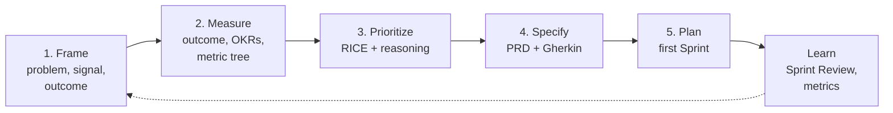
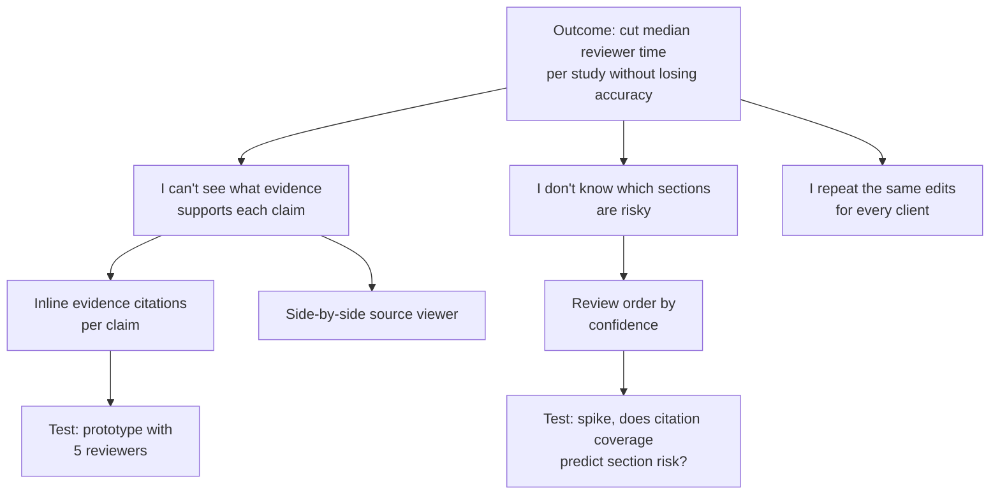
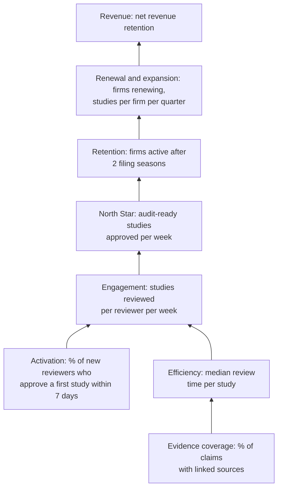

# Part 1 · Day 10 — Capstone: Run a Full Product Cycle End to End

**Date completed:** 2026-11-28 · **Time spent:** ~6 hours

## Success criteria

| Criterion (copied from the planner) | Done? | Evidence (link or section below) |
| --- | --- | --- |
| Runs a full product cycle end to end | Yes | [The cycle at a glance](#the-cycle-at-a-glance) · Steps 1–5 below |
| Frames a problem and connects it to a user signal and business outcome | Yes | [Step 1](#step-1-frame-the-problem) |
| Defines outcomes OKRs and a metric tree | Yes | [Step 2](#step-2-outcome-strategy-okrs-and-metric-tree) |
| Prioritizes with a framework and explains the reasoning | Yes | [Step 3](#step-3-prioritize-and-explain-the-reasoning) |
| Writes a sharp PRD with acceptance criteria | Yes | [Step 4](#step-4-prd-with-user-stories-and-acceptance-criteria) |
| Plans a first sprint with estimates and justified sequence | Yes | [Step 5](#step-5-plan-the-first-sprint) |
| Presents reasoning conceptually not as a past project | Partly | [Presentation to the pod](#presentation-to-the-pod): talk track ready, to be presented to the pod |
| Writes comprehensive reflection | Yes | [Reflection](#reflection) |

## Key learnings

### What the capstone brings together

*Sources: The Scrum Guide 2020, Opportunity Solution Trees (Torres), RICE (Intercom), Gherkin Reference (Cucumber), North Star Metrics (GoPractice), Story Points (teachingagile)*

| Step | Main idea I applied | From |
| --- | --- | --- |
| Frame | Start from an outcome. Opportunities come from real customer stories, and "Is there more than one way to solve this?" separates an opportunity from a solution. | Torres, Day 4 |
| Measure | The North Star must be a *growth* metric that captures total value. Guardrails stop it from being gamed. | GoPractice, Day 7 |
| Prioritize | RICE ranks impact per effort, but dependencies, table stakes and ethics can justify going out of order, as long as I say why. | Intercom, Day 5 |
| Specify | Acceptance criteria are examples in the domain's language, and Then steps must be observable. Objections become testable rules. | Cucumber, Day 6 |
| Plan | The Product Goal leads to a Sprint Goal. Developers size the work. Velocity is a forecast, not a target. Capacity adjusts it. | Scrum Guide, teachingagile, Day 9 |

## The capstone

**Problem I know:** reviewing AI-drafted R&D tax credit studies. This is the domain of **TaxVantage AI**, a multi-agent platform I built at Occams Advisory. It turns payroll, ledger, Jira and GitHub data into audit-ready R&D credit studies, which licensed tax professionals then review.

*Per the planner, this isn't a narration of what we did. It's a fresh run through the full cycle, applying this COE's methods to a problem in that domain. All signals, metrics and estimates below are illustrative.*

### The cycle at a glance



### Step 1: Frame the problem

**Problem statement:** licensed tax reviewers spend most of their review time checking whether each claim in an AI-drafted project narrative is actually backed by evidence. Reviews are slow, so firms can't increase the number of studies they deliver, which limits the product's value to them.

**User signal** *(illustrative)*:

| Signal | Source | What it suggests |
| --- | --- | --- |
| Reviewers open source documents for most narrative sections before approving | Product analytics: document-open events per section | They don't trust narratives without checking the evidence |
| "I spend more time finding the proof than reading the narrative." | Story-based interview with a reviewer ("Tell me about the last study you reviewed.") | The pain is *finding evidence*, not writing quality |
| Median review time per study is far above the firm's target | Review logs | Review is the throughput bottleneck |

**Business outcome:** firms complete more studies per quarter, which drives expansion revenue (per-study pricing) and renewals.

**Opportunity vs solution check:** "Add citations" is a solution. The opportunity is *"I can't quickly see what supports each claim."* There's more than one way to address it, so it's a real opportunity.



**Target opportunity:** *"I can't see what evidence supports each claim."* It's the most frequent signal, and it underlies the other two. Torres's caveat applies: the opportunities need confirming in 3–4 more story-based interviews before we commit.

### Step 2: Outcome, strategy, OKRs and metric tree

**Product outcome:** median reviewer time per study falls, while audit-readiness stays the same or improves.

**Simple strategy (Cagan's focus):**

- **Focus:** make evidence visible.
- **Not now:** more AI agents, new form types, or a new client portal.
- **Insight:** reviewers trust the AI when they can verify it quickly. Speed comes from trust, not from skipping review.

**OKR (committed, one quarter):**

> **Objective:** reviewers can verify an AI-drafted study quickly and confidently.
> - **KR1:** median reviewer time per study falls by 40% *(illustrative baseline)*.
> - **KR2:** 95% of narrative claims link to at least one source document.
> - **KR3:** zero unsupported claims found in a monthly 10% quality sample of approved studies.

**North Star Metric:** *audit-ready studies approved per week*

- **It's a growth metric** (total value created), as GoPractice requires. Review time is a *product* metric that feeds it.

**Guardrails:**

| Guardrail | Why |
| --- | --- |
| Unsupported claims in the quality sample = 0 | Stops speed from coming at the cost of accuracy |
| Reviewer time spent on high-risk sections doesn't fall | Catches **rubber-stamping**, the most obvious way to game the North Star |
| Audit challenges on delivered studies don't rise | The real-world test of quality |
| Reviewer satisfaction is stable or rising | Speed shouldn't come from pressure on reviewers |



**Reasoning:** evidence coverage is the *leading* lever. It drives review time, which drives studies per week. Renewal and revenue are the *lagging* results, and each has its own metric, so retention and monetization are treated as first-class, not assumed.

### Step 3: Prioritize and explain the reasoning

**Candidates scored with RICE** (Reach = reviewers per quarter, about 120. Score = R × I × C ÷ E):

| # | Candidate | Reach | Impact | Confidence | Effort (person-months) | RICE score | Rank |
| --- | --- | --- | --- | --- | --- | --- | --- |
| E | "Bulk approve" all high-confidence sections | 120 | 3 | 50% | 1 | **180** | 1 |
| B | Review order by confidence | 120 | 2 | 50% | 1 | **120** | 2 |
| A | Inline evidence citations per claim | 120 | 2 | 80% | 2 | **96** | 3 |
| C | Side-by-side source viewer | 120 | 1 | 80% | 1 | **96** | 3 |
| F | Exportable audit trail of reviewer decisions | 40 | 2 | 100% | 1 | **80** | 5 |
| D | Reusable reviewer edit templates per firm | 60 | 1 | 80% | 1 | **48** | 6 |

**Final order: A → F → B → C → D. E is a "no."**

| Decision | Why I'm going against or with the RICE order |
| --- | --- |
| **E is rejected, despite the top score** | It fails an *ethical* assumption (Torres): it encourages approval without review, which is exactly the rubber-stamping the guardrail exists to catch. Licensed professionals must review every section, so it also breaks a business constraint. A high score can't override a guardrail. |
| **A goes first, though it ranks 3rd** | B depends on A: "confidence" is only meaningful once we know which claims have evidence. A also directly addresses the target opportunity. |
| **F goes second, though it ranks 5th** | A Kano *basic* feature. Firms going through an audit need it, and its absence would cause dissatisfaction. High confidence, low effort. |
| **B goes third** | Promising, but confidence is only 50%. A spike in Sprint 1 tests the key assumption first. |
| **C goes fourth, D last** | C is useful, but A partly solves the same need. D serves fewer reviewers. |

The framework did its job: it made the trade-offs visible. Every place I go against it has a stated reason (dependency, table stakes, ethics), as Intercom recommends.

### Step 4: PRD with user stories and acceptance criteria

#### PRD: Evidence-linked narratives

| Section | Content |
| --- | --- |
| **Problem** | Reviewers can't quickly see what supports each claim in an AI-drafted narrative, so they search source documents manually. |
| **Outcome** | Median review time falls, with zero unsupported claims in approved studies (KR1, KR3). |
| **Users** | Licensed tax reviewers at CPA and tax firms. Firm admins are secondary. |
| **Riskiest assumptions** | *Desirability:* reviewers will rely on citations instead of re-checking everything (prototype test, 5 reviewers). *Feasibility:* claims can be matched to source records accurately (spike). |
| **In scope** | Citations for Jira and GitHub evidence first, a flag on unsupported claims, and a log of reviewer decisions. |
| **Out of scope** | Bulk approval, new form types, and payroll and ledger citations (next slice, after a privacy review). |
| **Constraints** (turned into acceptance criteria) | A licensed reviewer approves every section. The AI never marks a section approved. Client data stays in the firm's workspace. Every decision is logged. |

**User stories:**

1. As a **reviewer**, I want each claim in a project narrative to link to its supporting Jira or GitHub evidence, so that I can verify it without searching.
2. As a **reviewer**, I want claims without evidence to be clearly flagged, so that I know exactly where my judgement is needed.
3. As a **firm admin**, I want a record of every reviewer decision, so that we can show our review process during an audit.

**Acceptance criteria:**

```gherkin
Feature: Evidence-linked project narratives
  Reviewers see the evidence behind each claim so they can verify
  AI-drafted narratives quickly. A licensed reviewer always decides.

  Background:
    Given Anita is a licensed reviewer at a partner tax firm
    And she is reviewing the "Payments Engine" project narrative

  Rule: Every claim with evidence links to its source

    Scenario Outline: Claim supported by project evidence
      Given the claim "<claim>" is supported by <evidence>
      When Anita opens the narrative
      Then the claim shows a link to <evidence>
      And following the link shows that evidence

      Examples:
        | claim                                    | evidence               |
        | The team tested three retry algorithms   | Jira ticket PAY-142    |
        | A new reconciliation module was built    | GitHub pull request 87 |

  Rule: Unsupported claims are never hidden

    Example: Claim without evidence
      Given the claim "The team evaluated four vendors" has no linked evidence
      When Anita opens the narrative
      Then the claim is marked "Unsupported: reviewer input needed"
      And the section cannot be approved until Anita adds evidence or removes the claim

  Rule: Only a licensed reviewer approves a section

    Example: Approval is recorded
      When Anita approves the "Technical uncertainty" section
      Then the section shows "Approved by Anita" with the date
      And the decision appears in the firm's audit trail
```

**Non-functional criteria:** a linked source opens within 2 seconds, and client data isn't sent outside the firm's workspace.

### Step 5: Plan the first Sprint

**Sprint Goal:** *"Reviewers can see the evidence behind every claim backed by Jira or GitHub, and no unsupported claim can be approved unnoticed."*

**Sizing** (by Developers in Planning Poker, in a real team. Points here are illustrative):

| Backlog item | Points | Notes |
| --- | --- | --- |
| Citations for Jira and GitHub evidence | 8 | Matching accuracy is uncertain |
| Unsupported-claim flag and approval block | 3 | |
| Reviewer decision audit log | 5 | |
| Spike: does citation coverage predict section risk? | Time-boxed, 1 day | Unblocks item B |
| Citations for payroll and ledger evidence | 8 | Waits for a privacy review: next Sprint |
| Side-by-side source viewer | 5 | Later |

**Velocity and capacity:**

- **Velocity:** the last four Sprints were 19, 24, 20 and 21 → **average 21**, range 19–24.
- **Capacity:** one public holiday → about 10% less → **plan about 19 points.**
- **Planned:** 8 + 3 + 5 = **16 points + the spike**, leaving about 3 points of slack for the uncertain matching work.

**Justified sequence:**

| Order | Item | Why here |
| --- | --- | --- |
| 1 | Jira and GitHub citations | The target opportunity. Jira and GitHub are the most common evidence types *(assumption)*, and B depends on this item. |
| 2 | Unsupported-claim flag | Cheap. Turns the "never hide gaps" constraint into a testable rule. |
| 3 | Audit log | A Kano basic feature that firms need for audits. Low risk. |
| 4 | Spike | Answers B's biggest unknown while the citations are built |
| Next Sprint | Payroll and ledger citations | Sensitive data: depends on the privacy review, not on velocity |

**Definition of Done for these items:** acceptance tests automated from the Gherkin above, tests written first and passing, commit build green, deployed to staging, and a product walkthrough against the acceptance criteria (Day 3 DoD).

### Presentation to the pod

**What I did:** prepared a 10-minute talk track that walks the pod through the *reasoning* behind each decision, not the history of a past project.

| Slide | Message | The decision and why |
| --- | --- | --- |
| 1. Problem | Reviewers can't see what backs each claim | Signal first: analytics, an interview quote, review logs |
| 2. Opportunity | It's an opportunity, not a feature request | "Add citations" failed the solution-in-disguise test |
| 3. Outcome and North Star | Approved audit-ready studies per week | A growth metric, plus guardrails against rubber-stamping |
| 4. Metric tree | Evidence coverage → review time → studies → renewal | Shows where we can act now, and what lags |
| 5. Prioritization | RICE, and where I went against it | Rejected the #1 scorer on ethics. Moved two items up for dependency and table stakes. |
| 6. Spec | One rule per constraint | Objections became Gherkin rules |
| 7. Sprint 1 | 16 of 19 points, plus a spike | Slack for uncertainty. A dependency, not velocity, decides the next Sprint. |

**Questions I expect, and my answers:**

- *"Why not ship bulk approve? It scores highest."* → It removes the human review that makes the output trustworthy. The guardrail would fail immediately.
- *"How do you know reviewers want citations?"* → I don't yet. The prototype test with 5 reviewers is the first assumption test, before the full build.
- *"Isn't 16 points under-committing?"* → The matching work is our most uncertain item. Protecting the Sprint Goal matters more than filling capacity.

## Reflection

**What changed in how I work.** After more than eight years of taking products from 0 to 1, I came into this COE confident about delivery. What I hadn't done consistently was make my reasoning explicit and testable. These two weeks gave me a vocabulary and a discipline for that: outcomes instead of outputs, opportunities instead of feature requests, guardrails next to every North Star, and acceptance criteria that turn objections into rules.

**What was genuinely new.** Three ideas changed how I think. Fowler's argument that high internal quality is *cheaper*, not more expensive. XP's point that agile without technical practices quietly decays. And ATDD's idea that acceptance tests are the contract between people and the system, which matters even more now that AI writes so much code. My KPI work on CFO Insights AI, where calculation errors were caught in a final QA pass, now reads to me as a case for test-first examples and thin slices.

**How the capstone tested it.** Running TaxVantage AI's review problem through the full cycle showed me where the frameworks earn their keep. RICE ranked "bulk approve" first, and the guardrails and ethical assumptions caught why that would be a mistake. The data-privacy dependency, not velocity, decided what goes into the second Sprint.

**Where I still want to grow:**

1. **Continuous discovery:** weekly story-based interviews as a habit, not a project phase. My Day 4 trace showed decisions without a user signal behind them.
2. **Owning the persuasion:** writing the case down early and holding a reasoned line, instead of deferring after one discussion (Day 8).
3. **Working closer to engineering:** writing Gherkin with QA and developers in "three amigos" sessions, and understanding the test infrastructure well enough to make good quality trade-offs.
4. **Commercial modelling:** building unit economics into every major product decision, not only pricing discussions.

**My next 30 days:** run weekly reviewer or user conversations in my current product work, bring Given/When/Then examples to every refinement session, and present one decision memo with explicit trade-offs and a "what would change my mind" condition.

## AI use

- **Tools:** Claude.
- **Used for:**
  - structuring the capstone into this template and drafting tables
  - drafting the PRD, Gherkin, OKRs, sprint plan and talk track from the problem I chose
  - **generating all three Mermaid diagrams:** the cycle overview, the opportunity solution tree and the metric tree
  - calculating the RICE scores and velocity
  - checking that every success criterion has evidence
- **What I checked and corrected:**
  - Checked the North Star is a growth metric (GoPractice), and that the RICE scales and the "going out of order is fine if explained" rule match Intercom.
  - Checked the Gherkin against Cucumber's rules (Rule, Scenario Outline, observable Then steps, a short Background), and the Sprint Goal and sizing against the Scrum Guide and teachingagile.
  - The problem domain and product facts come from my own work on TaxVantage AI. All signals, metrics and estimates are illustrative, and no client or firm data is used.
  - The reflection is mine, drafted with Claude from my notes and corrected to reflect my own view.

## Open questions

1. For capstones based on real products, is the pod comfortable with the domain being named, as long as all data is illustrative?
2. When an AI feature's top-scoring idea conflicts with a compliance constraint, do Incubyte pods have a standard way to record that decision for the client?
3. What's the best next step for my growth: shadowing a senior product craftsperson's discovery cadence, or pairing with QA on acceptance tests?

## Changes after review

- None yet.
