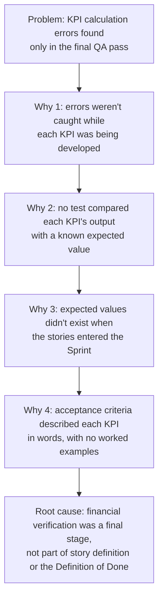

# Part 2 · Day 1 — Root Cause Analysis Done Properly & Structured Escalation

**Date completed:** 2026-11-28 · **Time spent:** ~4 hours

## Success criteria

| Criterion (copied from the planner) | Done? | Evidence (link or section below) |
| --- | --- | --- |
| Explains why root cause analysis aims at preventing recurrence | Yes | [Why root cause analysis exists](#why-root-cause-analysis-exists) |
| Distinguishes symptom and contributing factor and root cause | Yes | [Symptom, contributing factor, root cause](#symptom-contributing-factor-root-cause) · [Exercise 3](#exercise-3-every-cause-labelled-with-its-evidence) |
| Runs a 5 Whys backed by evidence | Yes | [Exercise 1](#exercise-1-5-whys-on-a-recurring-quality-problem) |
| Builds a fishbone without assumed causes | Yes | [Exercise 2](#exercise-2-fishbone-without-assumed-causes) |
| Explains blameless postmortems | Yes | [Blameless postmortems](#blameless-postmortems) · [Exercise 5](#exercise-5-blameless-postmortem-outline) |
| Labels causes on a real problem with evidence for each | Yes | [Exercise 3](#exercise-3-every-cause-labelled-with-its-evidence) |
| Writes a one-page escalation with facts and impact and options and a recommendation | Yes | [Exercise 4](#exercise-4-one-page-escalation) |
| Knows when and to whom to escalate | Yes | [When and to whom to escalate](#when-and-to-whom-to-escalate) |

## Key learnings

### Why root cause analysis exists

*Sources: 5 Whys Analysis (Atlassian Team Playbook), Fishbone Diagram (Lean Enterprise Institute), Postmortem Culture (Google SRE Book)*

- **Root cause analysis exists to stop a problem coming back,** not just to fix what's visible today. Atlassian lists "identifies root causes, not symptoms" and "prevents future issues" as its first benefits.
- **Without a formal way to learn from incidents,** they "may recur ad infinitum," and can grow more complex or cascade (Google SRE).
- **Fixing the symptom gets the system working again,** but the same failure comes back with the next change.

### Symptom, contributing factor, root cause

| Term | Meaning | How to spot it |
| --- | --- | --- |
| **Symptom** | What we see go wrong | It's the thing reported, such as "numbers were wrong" |
| **Contributing factor** | Made the problem more likely or worse, but removing it alone wouldn't stop it recurring | "If only this hadn't happened, it might have been caught" |
| **Root cause** | The underlying cause which, if changed, prevents recurrence, and which **the team can actually change** | The 5 Whys chain stops here |

### The 5 Whys, done properly

*Source: 5 Whys Analysis (Atlassian)*

- **The format:** pick one clear problem statement, ask "why?" up to five times, then propose a solution. Run it with 3–8 people in about 30 minutes.
- **Doing it properly** *(the planner's two rules)*:
  - **every answer is backed by evidence,** not opinion
  - **the chain stops at something the team can change.** "Five" is a guide, not a rule.
- **Its benefits:** it builds problem-solving skills, encourages questioning assumptions, and gives the team a shared understanding.

### Fishbone (Ishikawa) diagrams

*Source: Fishbone Diagram (Lean Enterprise Institute)*

- **Created by Kaoru Ishikawa in the 1960s,** a fishbone suits problems with **several contributing causes**.
  - The effect goes at the head.
  - Category "bones" branch off the spine. Traditional categories are people, equipment, materials, environment and methods. For software I used method, people, specification, tools, data and environment.
  - Specific causes branch off each bone.
- **Then analyse how the causes relate,** often with the 5 Whys, to find the root causes, and act on those.
- **The key warning:** include only *actual* causes. Things people believe or wish were happening turn a fishbone into a **"wishbone" diagram**.

### Blameless postmortems

*Source: Postmortem Culture: Learning from Failure (Google SRE Book)*

- **A postmortem is a written record** of an incident: its impact, the actions taken, the root causes, and the follow-up actions to prevent it recurring.
- **When to write one (triggers agreed in advance):**
  - user-visible downtime or degradation
  - any data loss
  - on-call intervention (a rollback, rerouting traffic)
  - long resolution time
  - monitoring failure
  - any stakeholder can also request one
- **Blameless:** focus on contributing causes, without blaming any person or team. Assume everyone acted with good intentions on the information they had.
  - **"You can't 'fix' people, but you can fix systems and processes."**
  - Blame makes people hide problems, which creates more risk.
  - The culture came from healthcare and aviation, where mistakes can be fatal.
- **No postmortem left unreviewed.** A senior review checks the data, impact, depth of root cause, action priorities and sharing. Then it's shared as widely as useful, and never includes data that could identify users.
- **The culture is built deliberately:**
  - a "postmortem of the month"
  - reading clubs
  - "Wheel of Misfortune" role-play
  - leaders taking part
  - visibly rewarding people who handle incidents well (the 4-minute rollback example)
  - asking teams for feedback on the process

### When and to whom to escalate

*Source: Escalation Management (CIO)*

- **Escalating isn't failure.** It's a tool for timely decisions. People delay because they fear it looks like failure or lack of ownership, think "it's not a big deal," worry about relationships, or fear retaliation.
- **When to escalate:**
  1. **Do your due diligence first.** Write down the options, with cost, customer and business impact, and pros and cons. Sometimes that alone resolves it.
  2. **If the people involved still can't agree, escalate.**
  3. **Time-box the investigation.** Escalate promptly to avoid analysis paralysis, because a late decision has its own business cost.
- **To whom:**
  - **Same manager:** escalate to that shared manager.
  - **Different managers:** a **joint escalation** to both managers at the same level. This avoids in-group bias and forces a neutral framing of the facts.
- **How:** a **one-pager** with:
  - context
  - customer impact and business impact
  - options with pros and cons
  - a clear summary of the disagreement
  - the specific decision you need
- **In a consulting pod** (Day 1 of Part 1), this means escalating early, with a suggested way forward, to the client product owner and the Incubyte delivery lead *jointly*, rather than letting a problem surface late in a status report.
- **Why escalating early with options beats escalating late with only a problem:** early, there are still options, and the decision-maker can choose. Late, the only remaining "option" is damage control. A problem without options also hands the thinking to the leader, while options with a recommendation show ownership.

## Exercises

### Exercise 1: 5 Whys on a recurring quality problem

**The problem (from my past product):** during the KPI expansion for **CFO Insights AI** at Occams Advisory, the QuickBooks-integrated financial intelligence platform, calculation errors in new KPIs kept being found only in the final financial-math QA pass, after the features were built.

**Problem statement:** *calculation errors in new KPIs are found at the end of the release, not while each KPI is built.*

| Why | Answer | Evidence |
| --- | --- | --- |
| 1. Why were errors found only in the final QA pass? | They weren't caught while each KPI was developed | The financial-math QA log: errors were found in the final pass, after development was "done" |
| 2. Why weren't they caught during development? | No test compared a KPI's output with a known correct value | The test suite had no tests asserting KPI values against expected figures |
| 3. Why was there no such test? | Expected values didn't exist when the stories entered the Sprint | Sprint backlog items for the 7 KPIs had no example inputs and outputs attached |
| 4. Why didn't the stories have them? | Acceptance criteria described KPIs in words ("show gross margin %"), not with worked examples | The KPI user stories' acceptance criteria |
| **Root cause:** why was that accepted? | Financial verification was treated as a **final stage**, not part of defining a story or of the Definition of Done | The team's Definition of Done at the time didn't include "verified against expected values." The process put finance review at the end. |

**Why I stopped here:** the next "why" would be something like "that's how the company always worked," which the team can't change. The Definition of Done and the way we write stories *are* things the team controls.

**Fix aimed at the root cause:** for every financial KPI, worked examples with finance-verified expected values are agreed *before* the Sprint, written as Given / When / Then (Part 1 Day 6), automated as tests (Part 1 Day 3), and "verified against expected values" is added to the Definition of Done. Introducing a financial-math QA process was the first step. Moving it to the start is the root-cause fix.

### Exercise 2: Fishbone without assumed causes

**What I did:** mapped every cause I could support with evidence onto six categories suited to software.

**Causes I left out ("wishbone" check):** I brainstormed these, but **had no evidence**, so they aren't on the diagram:

| Candidate cause | Why it's excluded |
| --- | --- |
| "The developers weren't careful enough" | No evidence, and it blames people, not the system (Google SRE) |
| "QuickBooks' API returns wrong data" | No evidence. The data was correct but varied by company setup, which *is* on the diagram as a data cause. |
| "The finance team didn't care about early review" | An assumption about motive. The evidence only shows *when* review happened. |

### Exercise 3: Every cause labelled, with its evidence

| Cause | Category | Label | Evidence |
| --- | --- | --- | --- |
| KPI calculation errors found only in the final QA pass | — | **Symptom** | The QA log from the final financial-math pass |
| Financial verification was a final stage, not part of story definition or the Definition of Done | Method | **Root cause** | The Definition of Done had no verification criterion, and the process put finance review last |
| Acceptance criteria had no worked examples with expected values | Specification | **Root cause** (linked to the above) | The KPI stories' acceptance criteria |
| All 7 KPIs built and tested as one batch | Method | Contributing factor | The release plan: one release, one QA pass |
| Finance expert reviewed only at the end | People | Contributing factor | Review dates relative to development completion |
| Developers interpreted formulas from written descriptions | People | Contributing factor | Clarification questions raised during development |
| No automated tests comparing KPI output with expected values | Tools | Contributing factor | The test suite contents |
| QuickBooks charts of accounts vary by company, so edge cases appear late | Data | Contributing factor | Errors in the QA log linked to specific account mappings |
| Release-date pressure for a single launch | Environment | Contributing factor | The launch plan and date |

**Why the label matters:** fixing a contributing factor alone, such as hiring more QA, would make the same failure *smaller* but not stop it. Fixing the root cause, by moving verification into the story and the Definition of Done, removes the reason errors survive until the end.

### Exercise 4: One-page escalation

**Scenario (the planner's sample, fictional):** a change to a payer's web portal broke our data scraper the day before an important client demo.

> **ESCALATION: Payer portal change broke the data scraper; client demo tomorrow at 11:00**
> **To:** client product owner and Incubyte delivery lead (joint) · **From:** product craftsperson, pod · **Decision needed by:** today, 18:00
>
> **Facts**
> - At 09:40 today, the scheduled import from one payer portal failed. The portal changed its page layout overnight, so the scraper can no longer find the claim-status fields.
> - The last successful import was yesterday at 22:00. All data up to then is complete and verified.
> - Other payer imports are unaffected. A fix is in progress. The engineers estimate 6–10 hours, with medium confidence, because the new layout isn't fully understood yet.
>
> **Impact**
> - **Client:** tomorrow's demo planned to show today's live claim statuses for this payer. Without a fix, that part of the demo can't show live data.
> - **Business:** the demo supports the decision to expand to more payers. A failed live demo would cost more trust than a planned adjustment.
> - **Wider risk:** portal layout changes can recur with any payer, without notice.
>
> **Options**
>
> | Option | Pros | Cons |
> | --- | --- | --- |
> | A. Fix overnight and demo live data | Shows everything as planned | 6–10 hour estimate. A rushed change risks failing during the demo itself. |
> | **B. Demo with yesterday's verified data, clearly labelled, while fixing in parallel** | Safe, honest, and still shows the full workflow | Data is about 12 hours old for one payer |
> | C. Postpone the demo | No risk in the demo | Delays the expansion decision. Signals instability. |
> | D. Remove this payer from the demo | Simple | Hides a known issue, which goes against our "be transparent" principle |
>
> **Recommendation: option B.** Demo with yesterday's verified data, labelled "as of yesterday 22:00," and say openly that a portal change is being fixed. If the fix passes its tests by 09:00, switch to live data. Afterwards, we'll run a blameless postmortem and propose a detection step for portal changes.
>
> **What I need from you:** agreement on option B by 18:00, and the client PO's view on whether to mention the issue proactively at the start of the demo. I recommend that we do.

**Why it's structured this way:** facts first, without blame; then impact on the client and the business; then options with honest trade-offs, including the ones I don't recommend; then a clear recommendation and a specific decision with a deadline. It goes jointly to both sides' decision-makers, as the CIO article advises.

### Exercise 5: Blameless postmortem outline

**What I did:** outlined the postmortem that would follow the scraper incident, written blamelessly.

| Section | Content |
| --- | --- |
| **Trigger** | A user-visible data degradation (one payer's data stale for about 12 hours), meeting the agreed postmortem criteria |
| **Impact** | One payer's claim statuses not updated for about 12 hours. The demo used labelled data from the previous day. |
| **Timeline** | 22:00 last successful import → 09:40 failure detected → 10:15 escalated → 18:00 option B agreed → fix deployed |
| **Root cause** | The scraper depended on the portal's page layout, with no check that would detect a layout change before a scheduled import |
| **Contributing factors** | No alert on "zero records imported." The import is detected only when it fails. |
| **Blameless wording** | Not "the scraper was badly written," but "the design relied on a page layout that can change without notice, and we had no early warning" |
| **Actions** | Add a daily layout check against expected fields, alert on unexpected zero-record imports, and add a runbook step for demo-day fallbacks. Each has an owner and a priority. |
| **Review and share** | Reviewed by a senior engineer, then shared with the wider pod. No personal or patient data included. |

## Reflection

I'm still in the early stages of my current role, learning a healthcare reconciliation product, and I caught myself doing exactly what this day warns against. In a walkthrough, when a sample of records didn't reconcile, my first note was "the matching is missing these records." That was a symptom written as if it were the cause. The product's PM pointed out that in reconciliation, most mismatches trace back to how the source data arrives (formats, missing identifiers, timing) rather than to the matching itself, and that the first question should always be "what does the evidence say about the inputs?" Looking back, the evidence that would have shown the difference was simple: comparing the unmatched records' source fields against the records that did match. From now on, when I report a problem, I'll separate four things: the symptom I saw, the evidence I have, my suspected cause, and what's still unknown. I'll treat a cause as confirmed only once the evidence supports it, just like the 5 Whys rule.

## AI use

- **Tools:** Claude.
- **Used for:**
  - structuring my notes into this template and drafting tables
  - drafting the 5 Whys, cause labels, escalation and postmortem from the problem and scenario I chose
  - **generating the Mermaid 5 Whys diagram in Exercise 1**
  - **generating the fishbone diagram image in Exercise 2** (made with Python)
  - checking that every success criterion has evidence
- **What I checked and corrected:**
  - The evidence in Exercises 1 and 3 describes the CFO Insights AI KPI expansion as I recall it. Claude helped structure it, and I reviewed it for accuracy.
  - Checked the 5 Whys and fishbone methods against Atlassian and the Lean Enterprise Institute, the postmortem practices against Google's SRE book, and the escalation guidance against the CIO article.
  - The escalation scenario is the planner's fictional sample. No client data is used anywhere in this file.
  - The reflection is based on my early experience in my current role, kept generic with no client details. Claude drafted the wording from my notes.

## Open questions

1. For client incidents, who owns writing the postmortem: the pod, the client, or jointly? Where are postmortems shared?
2. Are postmortem triggers already agreed with the client, or should the pod propose them?
3. For escalations to a client, is the joint escalation format (client PO plus Incubyte delivery lead) the expected standard?

## Changes after review

- None yet.
